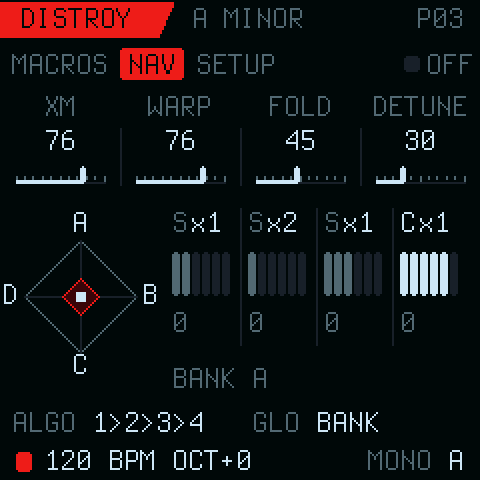
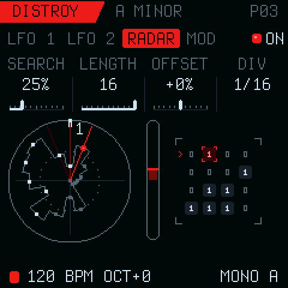
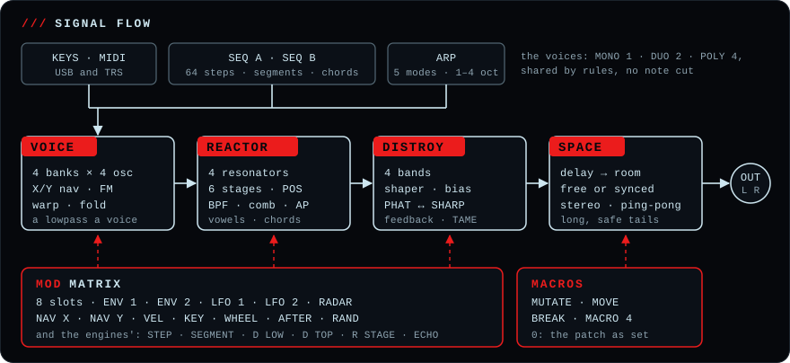
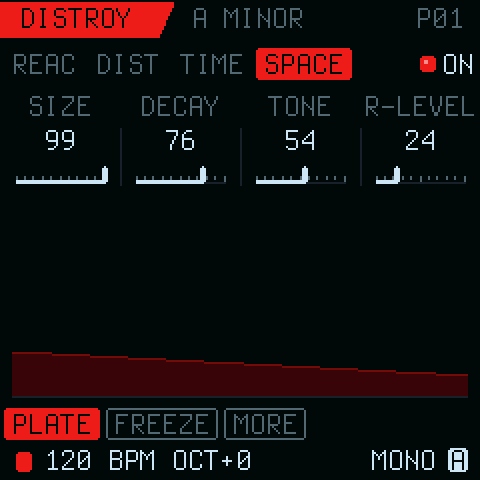
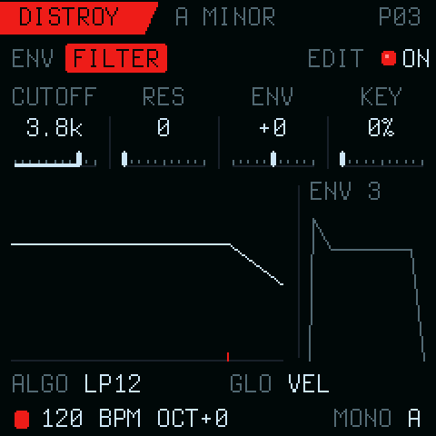
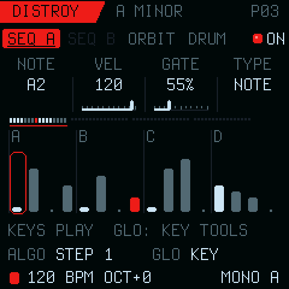

<p align="center">
  
</p>

<p align="center">
  <b>A starship FM synth for the M-VAVE FM-1.</b><br>
  Four banks of oscillators on an X/Y nav field · a morphing resonator · multiband destruction · delay and room
</p>

<p align="center">
  
  
  
  
</p>

<p align="center">
  <a href="https://joakimskurk.github.io/fm1stardistroyer/"><b>The page: hear it, play it in the browser, and install it →</b></a>
</p>

<p align="center">
  
  
  
</p>

Star Distroyer turns the FM-1 into one instrument with four engines in a row. A **voice** of sixteen oscillators,
morphed across an X/Y field; a **Reactor** of four resonators that sweep through vowels, chords and combs; **DISTROY**,
which splits the sound into four bands and wrecks each its own way; and **TIME** and **SPACE**, a delay and a looper
feeding a plate. Around them
are a modulation matrix with RADAR (a loop of random steps), four macros, a two-track step sequencer with segments, and an
arpeggiator. 29 patches come with it, and 32 places of your own.

> **Status:** the second beta, [0.3-beta](https://github.com/joakimskurk/fm1stardistroyer/releases/tag/v0.3-beta). Everything here
> runs on the host (the same C, the sound as WAV, the screen as images) and in the FM-1 emulator, but it has **not yet
> been tested on a real FM-1**: install it only if you are ready to take the way back (Install, below). What you save
> may not load in the next beta: the saves can change until 1.0.

<p align="center">
  
</p>

##  The sound

<table>
<tr>
<td width="264" valign="top"></td>
<td valign="top">

**VOICE**: four banks of four oscillators.
- Each oscillator is a harmonic 1–32 of the note with a fine tune, and a carrier or a modulator (series or
  parallel), read left to right.
- **XM** sets the FM, **WARP** turns sine → triangle → saw → pulse, **FOLD** folds, **DETUNE** spreads.
- The **NAV** X/Y blends the four banks. **COURSE** travels four stored X/Y cells (MONO): EDIT on NAV turns it
  **ON** (from each note, once round, held on the last), **LOOP** (round and round on its own, back to the first;
  a note does not start it again, PLAY does, in time with the sequencer) or OFF.
- Harmonic generators re-roll a bank (GLO + K4 on NAV): ALL, ODD, RND, CLUST, 14 chords, CPY, from a list as the knob
  turns, each with the harmonics it sets.
- **MONO**, **DUO** or **POLY**, the banks spread by WIDTH round the middle of what sounds (never more than 6 dB to a
  side; a corner's bank alone in the middle), and gentle aliasing tracking up high.

</td>
</tr>
<tr>
<td valign="top"></td>
<td valign="top">

**REACTOR**: a quad morphing resonator after the voice.
- Four filters of one model: BP6, BP12, a variable BPF, KP combs, delay allpasses (AP1) or IIR allpasses (AP2).
- Six stages hold every filter's pitch and level. **POS** moves through them, and **SLEW** jumps or glides.
- A stage clock (forwards, backwards, ping-pong, random) and key tracking. **HARM** snaps the filters to the note's
  harmonics.
- **MIX** keeps the dry voice whole up to the middle, and **LOW** lets the lows pass by. At 0 it is not there.
- In a patch without it, **EDIT** turns it on with six vowels on POS (A, E, EE, AW, OO, ER), so the knobs are heard
  at once.
- **STAGES** (GLO + D♯5 on its page; D♯5 again goes back) edits them: the white keys 1–6 pick a stage (POS goes
  there, so you hear it), **K1 TYPE** puts one of 13 vowels or 13 chords in it from a list, **K2 PITCH** moves it,
  **K3 WIDTH** spreads or closes it, **K4 LEVEL**; with GLO, F1–F4 one by one. SAVE keeps it with the patch.
- The picture: the filters as peaks across the frequency range, and under them the six stages as a piano roll, each
  its four filters as notes at their pitch, the one playing red.

</td>
</tr>
<tr>
<td valign="top"></td>
<td valign="top">

**DISTROY**: multiband destruction.
- Four bands, LOW, LO-MID, HI-MID and TOP (LR4 or complementary crossovers). ALGORITHM picks one, and the hint line
  names it.
- Each band: **TYPE** (NONE SOFT HARD FOLD CRUSH), **DRIVE**, what the type does (**KNEE**, **SPACING** or **DEPTH**)
  and **LEVEL**; with GLO, **BIAS**, **PAN**, **DYNAMIC** and **SPLIT** (its upper edge, in Hz).
- Dynamics in each band: **PHAT** lifts quiet parts and tails, **SHARP** spits transients, and **BODY** (GLO +
  ALGORITHM) sets where.
- The picture: the bands on a frequency axis, as tall as their drive, the splits in Hz under them. EDIT on a patch
  with no bands yet sets four that sound.
- A feedback loop (1–20 ms, spread) with **TAME** to darken it, and a safety limiter so it never blows up.

</td>
</tr>
<tr>
<td valign="top"></td>
<td valign="top">

**TIME** and **SPACE**: a delay and a looper into a plate, last in the chain (FX: REACTOR, DISTROY, SPACE, TIME; the looper on ARP, beside the arpeggiator).
- **TIME** is the delay: stereo or ping-pong, free (1 ms – 1 s) or on the beat (1/32 … 1/2, triplets, dotted), with
  **FDBK**, **TONE** and **D-LEVEL**; ALGORITHM: its **MODE**. Ping-pong comes in pairs: an echo on the left, then one as
  loud on the right. On the beat it stays on the beat: a division longer than its 1 s (1/2 under 120 BPM, 1/4D under
  90) plays at half, 1/2 as 1/4 and 1/4D as 1/8D. TIME turns red and the hint line says what plays.
- The **looper** (its own page, **LOOPER**, ARP's second: **GLIDE**, **LENGTH**, **SPEED**, **L-LEVEL**; EDIT arms it) records what you hear
  before the reverb, always. **LOOP** (ALGORITHM there) plays its last LENGTH round and round, while the delay goes on with what you
  play over it: a loop layer in the background. Synced, while the sequencer plays, LOOP locks on the beat: pressed a
  little late, the loop ends on the line you just passed and goes on at once; a little early, it waits for the line.
  The bar lines draw it most (a bar long: up to 60 % into the bar it takes the one just passed). It follows PLAY: **STOP** stops the loop too (it fades out and
  waits, kept), and **PLAY** starts it again in sync, where it stood against the one (a MIDI clock's START and STOP
  too; looped while stopped, PLAY puts its start on the one). To play on over the loop without the sequencer, turn
  the tracks OFF (EDIT) or clear them (CLR). **SPEED** takes it up to an octave up or down (the pitch and the
  length together, as a tape's), and **REVERSE** (GLO + ALGORITHM on LOOPER) plays it backwards, its attacks turned
  into swells, before it loops or while it does. **GLO + OCT- / OCT+** (on LOOPER) takes it to the next octave, and **GLIDE**
  is how long a new speed takes (OFF: at once, or 1/32 … 4 bars): an octave lands on the loop's own grid, gliding
  onto its beats and then crossfading into its place, so back at its pitch it plays exactly where it was. It goes
  into the reverb as the synth does (**R-SEND**, GLO's K2 there: how much), and into the delay if you want
  (**D-SEND**, GLO's K3), and **FILTER** (GLO's K1) is one knob, a lowpass to the left, a highpass to the right,
  none in the middle, no resonance. **EDIT** arms it, at any **L-LEVEL**, 0 too: take a loop with it silent and fade
  it in. The picture is a tape running past its head on the right: what it records drawn as it comes, the grid it
  locks to over it (the master's bars, the beats), the LENGTH LOOP takes framed with its ends on that grid; LOOP
  stops the tape and its head runs through the loop, red. Armed, it borrows the delay line's second half, which with the RAM's last 24 KB holds 5.1 s, mono at half
  rate in 8 bits (mu-law: a light tape), while the delay keeps the first half, 0.5 s (a longer division plays at half,
  TIME red); let go, the delay has its whole second again. Arming or letting go fades the echoes out and in, the
  line cleared. LENGTH synced reaches 4 bars, halved until it fits (what it holds: the end of LOOPER's scale). It is the
  player's, not saved with the patch.
- **SPACE** is the reverb, a **plate**: four diffusers into a tank of two branches in a figure of eight, its lines
  gently moving, so a long tail stays alive and never rings metallic. **SIZE** stretches it 0.35–1.75 x (turned, it
  glides there like tape), **DECAY** is its tail, 0.3 s to about 40 s, whatever the SIZE, **TONE** darkens it and
  **R-LEVEL** is how much. The echoes and the loop go into it.
- **FREEZE** (ALGORITHM on SPACE) closes the plate's input and holds its tail as it is, for as long as you like; play
  over it, turn ALGORITHM again and it dies away. It is the player's, not saved with the patch. **PITCH** (GLO's K2)
  takes the frozen tail up or down, up to an octave each way in semitones, without a break; back at 0, or the
  freeze let go, it is the plate's own again.
- **SHIMMER** (GLO's K1) sends an octave up of the tail back into it, a little more each pass:
  it climbs and fades, and stays stable at any DECAY.
- The plate and the looper run on the FM-1's **second core**, a block of 5.8 ms at a time beside the audio; the
  delay on the first, as it always has. The second core also takes half of every 0.7 ms of sound beside the first:
  two of the four banks, two of REACTOR's four resonators, DISTROY's right channel (the same sound bit for bit, on one
  core or two). Some FM-1s' second core misreads memory now and then: every job carries a
  check, and at the first sign of trouble (a misread, a job that does not come back, a fault) that core is held until
  the power is off: the first core does all of the sound, and the earlier room plays in the plate's place, the
  looper going on beside it: **ROOM** on SPACE's screen, and *2ND CORE OFF: ROOM* once. The room has no FREEZE or
  SHIMMER.

</td>
</tr>
<tr>
<td valign="top"></td>
<td valign="top">

**ENV and FILTER**
- **ENV 1** shapes the level and **ENV 2** the FM amount.
- A lowpass on each voice, LP12 or LP24, with **CUTOFF**, **RES**, its own envelope (ENV 3), key and velocity. It is
  off until you turn it on.

</td>
</tr>
</table>

##  Movement

<table>
<tr>
<td width="264" valign="top"></td>
<td valign="top">

**Four macros** on HOME. 0 is the patch as programmed.
- **MUTATE**: the voice's FM, warp, fold and detune.
- **MOVE**: the nav in orbit or jumping on the beat, the Reactor's POS, the width.
- **BREAK**: the Reactor's drive and DISTROY's gain, ALT, bias and feedback, the top bands first.
- **MACRO 4**: BODY, AIR or DROWN, as the patch chooses.

</td>
</tr>
<tr>
<td valign="top"></td>
<td valign="top">

**The modulation matrix**: eight slots a patch, from a source onto a destination by −99 … +99 %.
- **Sources:** ENV 1, ENV 2, ENV 3, LFO 1, LFO 2, RADAR, NAV X, NAV Y, VELOCITY, KEY TRACK, WHEEL (CC 1),
  AFTERTOUCH and RANDOM (each note). The engines feed it too: SEQ A's STEP and SEGMENT, the Reactor's STAGE,
  DISTROY's LOW and TOP BAND, TIME's ECHOES. SOURCE turns a list as DEST does, each with where it comes from.
- **Destinations:** 54, each named by the page its knob is on and the knob's name there, in the pages' order (and on
  each page its knobs', K1–K4, then GLO's): PITCH; NAV (XM … WIDTH); ENV 1 and ENV 2 (ATTACK, DECAY, SUSTAIN,
  RELEASE); FILTER (CUTOFF, RES, ENV) and ENV 3; REACTOR (POS, RES, SLEW, DRIVE, FREQ, MIX); DISTROY (DRIVE, all four
  bands' or each band's, BIAS, each band's SPLIT: a crossover moved past another goes through it, the band between
  closing and opening again on its other side; and its loop: FDBK, TIME, SPREAD, TAME, MIX); SPACE (SIZE, DECAY,
  TONE, R-LEVEL); TIME (the delay's TIME, FDBK, TONE and D-LEVEL, and the looper's SPEED, ±12 semitones, free: an LFO
  on it a tape's wobble, the loop's grid following it and taking it back after; from RADAR in whole semitones,
  through GLIDE); LFO 1 and LFO 2 (RATE). Turning DEST brings up the list, as PRESETS does: the page and the knob,
  the one picked in the middle. It plays as it turns and goes after 1.5 s. RADAR's DEST and ORBIT's lanes use the
  same list.
- **Two LFOs:** SINE TRI SAW RAMP SQUARE S&H, free (0.02–40 Hz) or synced (1/16 … 4 bars, from the one at PLAY),
  restarted by a note, or ONE cycle a note. On an LFO's own page K3 **DEST** and K4 **AMOUNT** send it somewhere
  (its first MOD slot, a free one the first time; DEST OFF lets the slot go), and ALGORITHM picks its **MODE**, said
  on the hint line (FREE RUNNING, SYNC TO THE TEMPO, FREE, RESTARTS EACH NOTE ...).

</td>
</tr>
<tr>
<td valign="top"></td>
<td valign="top">

**RADAR**, on LFO after the two LFOs: a loop of random steps, a modulation source of the patch. Off until you switch it on.
- A loop of **LENGTH** bits (2–16, 16 at first) steps on the tempo (ALGORITHM: 1/32 … 1/4). As each bit comes round, **CHANGE**
  is the chance it flips: 0 locks the loop, a little lets it drift, 100 plays it and its inverse.
- Its 8 newest bits are the output: a stepped value, every step a new one.
- **DEST** and **AMOUNT** send it anywhere the matrix can, XM by default. **NOTES** moves SEQ A's notes in the
  pattern's scale as they play, and never rewrites the pattern. To **PITCH** it is quantized first: every voice
  lands on a note of SEQ A's scale from its key (CHROM: whole semitones). In MOD it is a SOURCE too, for more
  places (to PITCH there quantized as well).
- The picture is a scope: the loop's places round it, its 1 at 12 o'clock (START plays it from there), each step
  held at its value over its arc (further out higher) and a hard jump to the next, as it sounds, the sweep on the
  step playing, the newest blip red. Locked (CHANGE 0) the shape stays; with CHANGE it drifts. A gauge beside
  it shows the value now.

</td>
</tr>
</table>

##  Playing it

<table>
<tr>
<td width="264" valign="top"></td>
<td valign="top">

**Two sequencer tracks on one sound**: a melody on A and a bass line on B, one tempo and one PLAY.
- Up to 64 steps: NOTE (or a SLIDE into it), TIE, REST or SKIP. Each has velocity, gate, **RATCHET** (2 or 3 hits)
  and **PROB**, and can hold a chord of up to four notes.
- **SELECT** picks the step (ALGORITHM too), in SEGMENTS the part. Stopped, the step picked sounds (a white key held,
  SELECT, ALGORITHM or its NOTE turned), so you hear what you edit.
- **The key** is the master's: GLO + ALGORITHM its scale, **GLO + SELECT its root** (the hint line says SELECT ROOT
  with GLO held). The notes stay as written. A pattern from before keeps the key it had (its step 1's note), and
  from then on writing step 1 no longer moves it.
- **B4 MORE** (C♯4): the step's RATCHET and PROB, and the note heard there: **MOVE** a step earlier or later and
  **LENGTH**, how many steps it holds (its TIEs). A join stays a join: a note played legato into the next keeps its
  end when it moves, and the note before holds into the step it leaves. It never takes another note's place.
- **Segments A–F:** up to six parts of the pattern, each with REPEAT, ORDER (forwards, reverse, ping-pong,
  random), SKIP and LENGTH. **D♯5** opens them: a white key picks the part its step is in (framed, the others dim),
  ALGORITHM sets how many parts (evenly), and the screen says how they play (PLAYS A B<x2 C D). D♯5 again: back.
- **REC** (or **B11**, the last black key, lit while it is on) records from the keys, and from a MIDI keyboard at its velocity (USB or the TRS jack): stopped, step by
  step (keys held together, a chord); playing, into the step that plays, and a key held on writes a TIE into each
  step it is held over, so a note is as long as you held it (a new key while one is held is the next note, legato,
  unless it comes in the same step: a chord). Play over a wrong note and it is replaced. It writes what you hear: under a transpose
  (GLO's, or ORBIT's XPOSE) a key goes in back by it, so the step plays the note you played.
- **One key, the master's:** its step 1 is the root and its SCALE (GLO + ALGORITHM on its page) the scale; the hint
  line shows it with GLO held (A MINOR). The other track has none of its own: what it plays is pulled to the nearest
  note of the key, and on its page the hint line says whose key it follows (KEY SEQ A).
- **GLO held** transposes a track from the keys, taken at its next one: the keys in the key are lit, and the root goes
  to the one you press (the root itself: no transpose). The keys stay as printed whatever OCT's octave (OCT is the
  playing's), and GLO + OCT moves the transpose an octave (to ±24; GLO + K4 XPOSE sets any).
- **IN KEY** (the default): a transpose moves the notes in degrees of the key, and a chord moves tone by tone (C minor
  up a third in C minor: E♭ major); K4 XPOSE and ORBIT's XPOSE count the same, +5 up a fourth in the key, +7 a fifth.
  **SETUP**'s XPOSE switches to **CHROM**: each track as written, transposed in semitones (from C4, every key lit).
- **COLOUR** (on **SETUP**, K4): the screen's accent, red by default, or orange, pink, magenta, violet, blue, cyan
  or green, from a list; the whole screen takes it at once, kept when switched off.
- **MASTER** (on **SETUP**, K3): A or B, the track whose one leads; its tab is underlined. While the master plays, the other track and ORBIT switched on come in at its next
  one, from their step 1 (ON blinks until then); off is at once. ORBIT counts the master's loops; the key (IN KEY)
  is the master's, and RADAR's NOTES stay SEQ A's.

</td>
</tr>
<tr>
<td valign="top"></td>
<td valign="top">

**ORBIT**, SEQ's third page: a sequencer over the sequencer, for a change over time.
- 2–8 steps on the first white keys, each **1, 2 or 4 loops** of the master (SEQ A unless you choose B); a step
  changes at its one. The LED under
  each step's stripe lights while it plays.
- Each step: **XPOS A** and **XPOS B** (±24, the transpositions), two free lanes each to its **DEST** (any matrix destination,
  ±100 %), and with GLO the four macros' changes. Every value is a change from where you are: 0 changes nothing.
- **The step you pick is the one you hear:** a white key, SELECT or ALGORITHM (or a knob turned on it) holds ORBIT
  on that step while it plays (the hint line's lamp lit, its light under the stripes red), so you hear your edit; the
  same key again, or leaving ORBIT, lets it go on, in time, where it would have been.
- **B10** (D♯5, lit) is SETUP: LENGTH, RATE, DEST 1, DEST 2; with GLO, **GLIDE** for each lane and the macros
  (jump at the step, or glide through it to the next). EDIT switches it; it is saved with the pattern.

</td>
</tr>
<tr>
<td valign="top"></td>
<td valign="top">

**ARP**: UP, DOWN, UP-DN, RND or ORDER over 1–4 octaves, RATE 1/64 … 1/2 (triplets and dotted too), GATE and HOLD,
on the tempo. While the patterns play, ARP sits on the same grid as them, counted from START: a hand put down just
after a step plays at once and the next note lands on the grid; one put down later waits for the next step. Stopped,
ARP runs from the key. **REC on ARP keeps what it just played**: the last bar at its RATE becomes a SEQ track's pattern, at
that DIV, so you can save a run you liked after the fact. It goes to SEQ A, or to SEQ B while A plays. Press REC on
the one and you keep the bar that just ended. UNDO on SEQ takes it back, and SAVE there keeps it.

**The voices are shared by rules.** MONO has 1, DUO 2, POLY 4, and a sound is the same in each: DUO and POLY play
the banks MONO weighs most where X / Y is (at each note), and a note is as loud as in MONO (the voices sharing the
level by how loud each sounds, so a chord is no louder than four voices always were). A playing track takes its widest chord, ARP takes one,
and the keys take the rest. No source cuts another's note. What does not fit is refused with a short message.

The keys remember what is held: in MONO, hold a note, play a second and let it go, and the first sounds again,
legato.

**MIDI clock**, over USB or the TRS jack, leads while it comes (SYNC AUTO): both tracks, ORBIT, ARP, RADAR, the
synced LFOs and MOVE move by its pulses, so they cannot drift from the other gear, and SPACE's synced echoes take its
tempo. START or CONTINUE plays from step 1 at the next pulse, STOP stops, and the status line shows the clock's tempo
with **CLK**. Without pulses for half a second, the FM-1's own tempo takes over. **SETUP**'s SYNC (GLO + K1) switches to INT,
where a clock is not heard. With two clocks at once (USB and the jack, or two MIDI inputs in the browser), the first
leads until it stops.

</td>
</tr>
</table>

### The controls

Every page is laid out the same, from the top: the patch's line (its name, the key, the master's, as IN KEY
transposes in it, the battery, three bars, and its place, P01 or U01); its button's pages (the current one the red tab, EDIT's lamp and ON /
OFF on the right; a page button brings back the page it showed last, and again the next; HOME always starts at
MACROS, where the FM-1 starts too); K1–K4 in a row like the knobs, each value on a printed scale with its pointer, grey
while the page's engine is off; the picture, the page's room (SEQ's steps in it); the hint line, two fixed places like
a panel's legends (ALGORITHM's job on the left, GLO's or a key's from the middle; with GLO held ALGO turns red and
shows its second job; what ALGORITHM switches on and off has a lamp there); the status. Halfway
between a starship's screen and a synth's panel: boxes with soft corners, lamps, scales; red is the patch, where you
are, what is on and what plays. The key
LEDs show what the keys do, and a black key with a job has one mark on the screen wherever its job is named (SEQ's
line, the hint line): a small key with its lamp, lit as the key is (dark, a glow, full, blinking), then the job's
name. The status line: PLAY's square (red while it plays), the tempo (**CLK** while a MIDI clock
leads), the octave and MONO, DUO or POLY (always) with who holds the voices (**A** and **B** the tracks, **R** the ARP, **-**
the keys). The CPU is on SETUP.

| Control | What it does |
| --- | --- |
| **HOME** | MACROS → NAV → SETUP (TEMPO, with GLO SYNC AUTO or INT; XPOSE IN KEY or CHROM, MASTER A or B, COLOUR: one knob each, kept; ALGORITHM **CLEAR ALL**, a start from scratch: SEQ A, B and ORBIT empty, the MOD slots, RADAR, the macros and COURSE back to none, ARP, the looper and FREEZE off, OCT+ yes, the sound itself kept; the CPU, a lamp for each core (the second red if it gave up: the reverb then the room's), and the battery's volts) |
| **FX** | REACTOR → DISTROY → SPACE → TIME |
| **ENV** | ENV → FILTER |
| **LFO** | LFO 1 → LFO 2 → RADAR → MOD |
| **ARP** | ARP → LOOPER: the arpeggiator and the looper, the player's tools (not saved in the patch) |
| **SEQ** | SEQ A → SEQ B → ORBIT |
| **K1–K4** | the four values in the row on top; on the FM-1 a fast turn goes further (slow, a step a detent; a fast spin crosses a level, an amount or the cutoff in about a turn), a list, a note or a semitone still one a detent |
| **GLO** | held, the second layer (the names turn red); a tap latches it (GLO lit) and a tap again, or a page button, lets it go, so a hand can stay on the knobs; on SEQ, the keys transpose the track, in the master's key, the keys in it lit, and OCT moves it an octave; on LOOPER, OCT the loop's octave |
| **ALGORITHM** | the page's choice, named on the hint line (on DISTROY the band, then LOOP: its frame moves in the picture; on NAV the algorithm, a list); GLO + ALGORITHM the second |
| **EDIT** | ON / OFF of what the page shows: COURSE (OFF, ON, LOOP), REACTOR, DISTROY, SPACE, TIME, LOOPER (armed), FILTER, ARP, a track, ORBIT, RADAR (a track or ORBIT, while the master plays: in at its one). Off, the hint line says OFF: EDIT TURNS IT ON (not on SEQ and ORBIT, where you write a part while it is off) |
| **PRESETS** | the patch (on SEQ and ORBIT the pattern; the list says PATCHES or PATTERNS): a list as it turns, the sound as it is; **EDIT** or **OCT+** loads, **OCT−** or HOME not now |
| **SELECT** · **SEL** (SCALE on the SMK-37) | which one, where a page has them in a row: SEQ's step (SEGMENTS: the part), ORBIT's step, REACTOR's stage (STAGES), DISTROY's band, MOD's slot, SAVE's place · MONO → DUO → POLY |
| **PLAY** · **REC** · **SAVE** | the sequencer · recording · a place of your own (32 patches, 32 patterns) |
| **OCT−** · **OCT+** | the keys' octave, on every page (on SEQ, GLO + OCT the transpose's); to a question (the list, SAVE, CLR) **OCT+** is yes and **OCT−** no |
| **The keys** | play; on SEQ the white keys are the steps and the black keys, lit where they do something, B1 RND, B2 UNDO (lit while there is something to take back), B3 CLR (blinking while it asks), B4 MORE (the step's RATCHET and PROB, its note's MOVE and LENGTH), B10 SEG (SEGMENTS: a white key picks the part its step is in, ALGORITHM how many parts, K1–K4 its REPEAT, ORDER, SKIP, LENGTH; the picture shows how they play) and B11 the keys into the steps (REC); on ORBIT the first white keys its steps, B10 SETUP; on REACTOR GLO + B10 STAGES (B10 again: back), there the white keys 1–6 the stage. Where the keys play, a black key does something only with GLO |
| **MIDI in** | USB or the TRS jack, any channel: notes play as the keys do on every page (into ARP while it is on; REC writes them, at their velocity), CC 1 the WHEEL, channel pressure AFTER, and a clock |
| **MASTER** | the volume |

The whole map is at the top of [`firmware/src/stardistroyer.c`](firmware/src/stardistroyer.c).

##  The patches

<p align="center">
<code>GROWL</code> <code>VOYAGE</code> <code>DISTROY</code> <code>VOWEL</code> <code>CHORDS</code> <code>PLUCKS</code> <code>FLANGE</code> <code>PHASER</code> <code>FUSION</code> <code>SPLIT</code><br>
<code>COMET</code> <code>NEBULA</code> <code>PULSAR</code> <code>ION</code> <code>ORBITAL</code> <code>MONOLITH</code> <code>STRINGS</code> <code>HALO</code> <code>AURORA</code> <code>TITAN</code><br>
<code>DRIVE</code> <code>UNDERTOW</code> <code>IMPACT</code> <code>BRAAM</code> <code>SCREAM</code> <code>BEACON</code> <code>DEPTH</code> <code>SHARDS</code> <code>PRISM</code>
</p>

DISTROY is the one it starts on: everything at once.

Two patches start from a plain FM sound and carry the Star Distroyer edge: the body stays as it was, only the top
band is destroyed, and something steps on the beat.
- **GROWL:** its top is destroyed in time with its fold.
- **AURORA:** a glass pad, its top folded to a sheen that takes a new depth each bar.

The patches live in [`firmware/src/sd_patches.h`](firmware/src/sd_patches.h).

### The lab

The lab is Star Distroyer as one window on this computer, the way a software instrument has it: every section of the patch at once, in the order the sound goes, with no pages to turn. NAV's
field to drag between the four banks, the oscillators, VOICE and MACROS; the three envelopes drawn, the filter's curve,
the LFOs; the Reactor's six stages on the pitch; DISTROY's four bands on the spectrum, their splits to drag; TIME with
its echoes and the looper (its loop drawn, the head going round), SPACE, RADAR (its register stepping) and the mod
matrix; then the SEQUENCER (the tempo, the voices, ARP; SEQ A and B, their steps, their segments, the step picked) and
ORBIT's lanes, the firmware's own patterns. The keys are along the bottom (the mouse, the computer's keyboard or a MIDI
keyboard), and the FM-1's own panel opens behind its button: its knobs and the window set the same patch, so each
follows the other.
- **A / B** against the patch as loaded, **UNDO** and **REDO**, **RESET**; a double click puts a control back as
  loaded, and a red dot marks what has changed.
- **KEEP** puts it in a library in this browser; **EXPORT** and **IMPORT** move it as JSON.
- **C** gives it as an entry of `SD_PATCH[]` in `sd_patches.h` (its name goes in `SD_PATCH_NAME[]`).
- **● REC** records the firmware's own frames, as they leave it, to a WAV.

Its sound is the firmware's: the same C, built as WebAssembly. `tests/lab_test.mjs` plays a script through it a
millisecond at a time and through `tests/host.c`, and the two are the same sample for sample; the C it exports
compiles back to the same bytes, for every factory patch and for one with every field at random. It is not on the
site: `tools/lab.sh` builds it from the source as it is into one file, `build/star_distroyer_lab.html` (the firmware,
its worklet, the font and the pictures inside it; nothing fetched), and opens it. The file runs from the disk in
Chrome, Edge or Brave and can be copied anywhere; EXPORT moves a patch between browsers.

##  Install

The beta is on [GitHub](https://github.com/joakimskurk/fm1stardistroyer/releases/tag/v0.3-beta): `stardistroyer-0.3-beta.fwsc` is the FM-1's (the `-smk37` packages are the
SMK-37's, untested on one too). [The page](https://joakimskurk.github.io/fm1stardistroyer/) installs the latest build
of `main` from the browser (Chrome or Edge, over USB MIDI); or build the package yourself (below) and install it with
`tools/fm1_install.py`. Either way, installing it is on you: it has not been tried on a real FM-1 yet.

1. **Back up your FM-1's flash first**, with M-Flasher or MvaveFM1Unbricker. Star Distroyer saves where the Felucca
   family keeps its data (settings at 0xFC000, patches and patterns from 0x97000). It reads only its own saves, and
   its first SAVE can overwrite another firmware's projects.
2. Install it from [the page](https://joakimskurk.github.io/fm1stardistroyer/#install), or the package over USB:

   ```sh
   pip3 install mido python-rtmidi
   python3 tools/fm1_install.py build/stardistroyer.fwsc     # it asks before it writes
   ```

3. **The way back:** install any firmware from the FM-1 Firmware Hub, or hold **OCT−** while switching on for the USB
   rescue. If even that does not start, the FM-1's own boot ROM still updates over USB
   ([FM-1-transporter](https://github.com/kurogedelic/FM-1-transporter)).

The package accepts both FM-1 flash chips: the first units' Puya P25Q80 (0x856014) and the UC25HQ80 (0xB36014) in
units sold since autumn 2026. A development build identifies as `FM-1_96200`, a release X.Y as `FM-1_962XY` (0.3-beta: `FM-1_96203`).

##  Build from source

The toolchain, the JieLi SDK and the host mode are as Dinghy sets them up:
[docs/DINGHY.md](docs/DINGHY.md#2-set-up-once).

```sh
tests/run_sd.sh                              # the engine's tests (also under ASan/UBSan) and the renders
tests/run_host.sh tests/scripts/q1.txt       # the whole firmware on the host: a WAV and the screens
./build.sh                                   # -> build/stardistroyer.fwsc
tools/emu_strict.sh build/stardistroyer.fwsc # the chip's load as the FM-1 has it (fm1-live)
sh tests/run_tests.sh                        # the update path, the loader, the installer, the flash maps
sh web/app/build.sh                          # the player: the firmware as WebAssembly (clang + lld, wasm32)
node tests/web_test.mjs build/web/stardistroyer.wasm   # ... boots, plays, turns pages, saves
tests/run_host.sh tests/scripts/lab.txt && \
  node tests/lab_test.mjs build/web/stardistroyer.wasm build/host/stardistroyer.wav   # the lab: the host's sound
tools/lab.sh                                 # the lab on this computer: one HTML file, built and opened
```

The page's player (`web/app/`) is the same `firmware/src/stardistroyer.c`, built on `web/app/web_host.c` (an FM-1 for
the browser, as `tests/host.c` is one for a computer) instead of the chip: no imports, no C library. It runs in the
page's audio thread (`worklet.js`), its main loop a pass for each millisecond its sound is worth; `player.js` draws
the FM-1's panel around its screen. Without a wasm32 clang here, any Docker image with clang and lld builds it:
`docker run --rm -v "$PWD":/w -w /w IMAGE sh web/app/build.sh`.

`tests/run_sd.sh` also renders the demos into `build/audio/`. Each is played the way one person plays one FM-1: a
stock patch, the app's own controls and the voice rules.
- **DERELICT** (`derelict/`, ~1:41, C minor at 84 BPM): an overture of four themes in four-bar turns, four such
  passes on one FM-1 layered, never more than four at once, with each pass's stem and every gesture in
  `performance.txt`.
- **The song** (`song/`, ~3:25, D minor at 112 BPM).
- **RANGE** (`range/`, ~137 s): the instrument's span in seven scenes, with every gesture listed in
  `performance.txt`.
- **CINEMATIC** (`cine/`, ~69 s, D minor at 84 BPM): a cue, eight parts layered as a multitrack, with their stems.
- **TAPESTRY** (`tapestry/`, ~88 s, D minor at 84 BPM): the looper building the bed. PRISM's falling sixteenths in
  the plate, looped, played backwards and taken down an octave; AURORA's slow line over it, FREEZE and SHIMMER on the
  plate. One pass, every gesture in `performance.txt`, the looper on the FM-1's own memory (armed before LOOP).
- **HELIOPAUSE** (`heliopause/`, ~1:47, E minor at 80 BPM): a cue, ambient for sixteen bars, then a wall, then its
  freeze. Everything RANGE plays (the nav and its generators, the acid with RADAR on the CUTOFF, the Reactor's vowels,
  the arpeggiator over the chords, DISTROY's riff and macros, RADAR's NOTES, the delay's echoes) in four passes on one
  FM-1 layered, the patches saved wet, the looper as its texture: the bed's last bar held, backwards, an octave down
  under a FREEZE that SHIMMER takes an octave up, an LFO on its SPEED for a tape's wobble, then two octaves up over two
  bars into the wall, and two back down under the wall's frozen plate. Each pass's stem and every gesture in
  `performance.txt`; the looper on the FM-1's own memory, as TAPESTRY's.
- **SINGULARITY** (`singularity/`, ~1:57, F minor at 72 BPM): one take, one stem, nothing layered: one FM-1 at
  full. What sounds over what is the instrument's own: the looper holding a bar of one patch while the next plays,
  FREEZE holding the plate's tail across a patch change, the delay. AURORA's glass chords and arp, looped, backwards,
  an octave down under SHIMMER and FREEZE; VOWEL on SEQ A and B, RADAR's NOTES, LFOs on the Reactor's vowels and the
  loop's SPEED; the loop two octaves up into a wall of DISTROY with all four of POLY's voices busy (SEQ A's riff, SEQ
  B's bass, the arp), ORBIT stepping both, RADAR on the FOLD, BREAK, BODY and CRUSH; then the wall frozen and the
  loop falling. Every gesture in `performance.txt`; the looper on the FM-1's own memory, as TAPESTRY's.
- The second cue (`epic/`, its parts layered as engines, with its stems), and the loops of the identity patches.

Screens and banner: `tools/make_readme_art.sh`. The logo comes only from `tools/gen_logo.py`.

##  Under the hood

- **Integers only:** fixed point throughout, no float and no 64-bit division in the audio. It renders in 32-frame
  sub-blocks inside the FM-1's audio interrupt, with modulation at the control rate.
- **The reverb has a low cut:** its tail rolls off from about 200 Hz, so it never muddies the low end; the dry
  sound keeps all of it.
- **Headroom:** nothing inside clips hard. Every ceiling a signal can meet (the voice filter, the Reactor's lines,
  DISTROY's sum, SPACE's return and the plate, TIME and the looper) rounds off instead of cutting, the banks' sum
  loses what is under 30 Hz before the FX, and the output its DC. `test_headroom` plays every patch, as made and with
  everything at full, and fails if a ceiling is pushed deep, the output reaches its shoulder, or DC is left.
- **CPU:** the app's own meter (the worst audio interrupt of a second) in fm1-live's realistic mode, which times each
  instruction and the flash cache's misses as the chip does (`tools/emu_strict.sh`; it matched a real FM-1 on
  2026-11-16): DISTROY's loop 51.7 %, the looper armed 53.6 %, everything at once (POLY with a chord, both tracks,
  ARP, all FX, all eight slots, RADAR and ORBIT) 58.9 %. The audio's hot code runs from RAM, and the second core
  takes half of every sub-block beside the first, besides the plate and the looper; from the flash on one core it
  read 98 % (113 % everything at once). On one core (a second core that misreads) the room plays there: 74.7 %,
  everything at once 82.8 %, the sound otherwise the same. Dinghy's [rules](docs/RULES.md) ask for under half,
  because USB, the key scan and the screen need the rest.
- **The output:** a limiter that looks 1.45 ms ahead turns a peak down before it comes, to −1.4 dBFS, so extreme
  modulation, the macros at full or a loud POLY chord never square off; a soft shoulder after it is the last safety.
- **Generated:** the oscillator's laws are tables from `tools/gen_tables.py`.
- **The plans:** [the sound](docs/sd/Star_Distroyer_FM1_Sound_Plan_v0.1.md) and
  [the sequencer](docs/sd/Star_Distroyer_FM1_Sequencer_Plan_v0.2.md): the design, what each step decided, the numbers
  now.
- **The platform's docs:** [API](docs/API.md), [rules](docs/RULES.md), [SMK-37](docs/SMK37.md) and
  [make it yours](docs/MAKE-IT-YOURS.md).
- **Departures from Dinghy 0.5's own files:**
  - `firmware/src/gfx.c`: the canvas without a `.pool` section on a macOS host and in the browser.
  - `firmware/src/platform.c`: with `DINGHY_WEB`, the browser's FM-1 (`web/app/web_host.c`) in place of `tests/host.c`.
  - `firmware/hal/fm1_flash_map.h`: a build-time check that both FM-1 flash parts pass.
  - `tools/build.py`: the identity FM-1_962XY; it assembles `hal/fm1_cpu1.S`, and its check of the RAM code lets
    the second core's loop make its one call, the job, and the audio's code in RAM (`.ram_audio`) call as any code.
  - `firmware/app.ld`: the RAM code region runs to 0x01C07F00 (was 0x01C06000; crt0's STATUS above it stays), and
    the audio's hot code (`.ram_audio`: the voices, REACTOR, DISTROY, SPACE, the render) is linked after the second
    core's loop: from the flash it missed the cache, which both cores share, and the FM-1 read 90 to 100 %. In the
    flash, after crt0: memcpy and memset (the RAM code calls them directly, and a call reaches only the flash's first
    KB), then the audio's flash code (`.text.sd_hot`: the control tick's parts, the plate's job) in 34 KB of its own,
    then the tables (`.rodata`) before the rest of the code, so the flash cache sees the audio at one place whatever
    else changes.
  - The second core, from felucca-bsp (MPL-2.0, [LICENSING.md](LICENSING.md)): `firmware/hal/fm1_cpu1.h`,
    `fm1_cpu1.S` and `fm1_cpu1_stop.h` are new. `firmware/app.ld` links its loop (`.c1_text`) into the RAM code;
    `firmware/hal/fm1_flash.h`'s `irq_save` waits for it to be idle before the flash goes off; `fm1_irq.h`'s
    `fm1_fault_c` hands it a fault first; `fm1_sys.h` holds it before a reset or an update; `platform.c` holds it
    first thing at boot and, with `FM1_CPU1`, starts it before the audio.
  - `firmware/hal/fm1_ram2.h` is new: the RAM2 test build's look for a second RAM bank (it sets nothing up; no
    firmware for the FM-1 is known to use one).
  - `.github/workflows/release.yml`: it also runs on every push to `main`, and publishes the page (`web/`) with the
    player built and tested, and the lab's test; a tag with a suffix (`v0.1-beta`) is a pre-release.

##  Credits and licence

Star Distroyer is by [joakimskurk](https://github.com/joakimskurk). It is built on
[Dinghy](https://github.com/zvenson/dinghy) by zvenson, which is based on
[Felucca](https://github.com/hugelton/Felucca) by Leo Kuroshita (Hügelton Instruments), with its platform as
[SLOOP](https://github.com/isod89/sloop-fm1) (isod89) carries it. The logo's letters are
[Orbitron](https://github.com/theleagueof/orbitron) (The League of Moveable Type, SIL Open Font License). Who made
which part is in [LICENSING.md](LICENSING.md).

GPL-3.0-only: you may change and share it, and whoever gets your firmware gets its source. "M-VAVE" and "FM-1"
belong to their owners. Star Distroyer is not made or endorsed by them.
