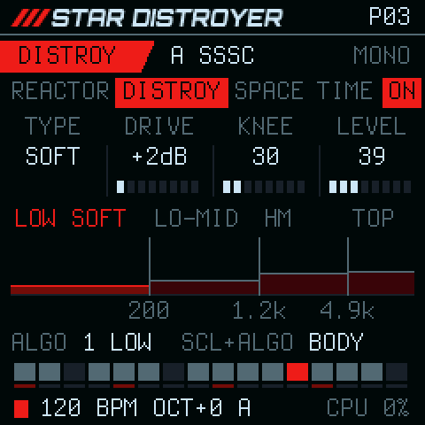
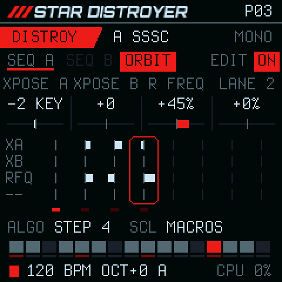

<p align="center">
  
</p>

<p align="center">
  <b>A starship FM synth for the M-VAVE FM-1.</b><br>
  Four banks of oscillators on an X/Y nav field · a morphing resonator · multiband destruction · delay and room
</p>

<p align="center">
  
  
  
  
</p>

<p align="center">
  <a href="https://joakimskurk.github.io/fm1stardistroyer/"><b>The page: hear it, play it in the browser, and install it →</b></a>
</p>

<p align="center">
  
  
  
</p>

Star Distroyer turns the FM-1 into one instrument with four engines in a row. A **voice** of sixteen oscillators,
morphed across an X/Y field; a **Reactor** of four resonators that sweep through vowels, chords and combs; **DISTROY**,
which splits the sound into four bands and wrecks each its own way; and **TIME** and **SPACE**, a delay and a looper
feeding a plate. Around them
are a modulation matrix with a Turing machine, four macros, a two-track step sequencer with segments, and an
arpeggiator. 29 patches come with it, and 32 places of your own.

> **Status:** a test release, [0.1-test](https://github.com/joakimskurk/fm1stardistroyer/releases) (a beta). Everything here runs on the host (the same C, the sound as
> WAV, the screen as images) and in the FM-1 emulator, but it has **not yet been tested on a real FM-1**: install it
> only if you are ready to take the way back (Install, below). What you save may not load in the next test or beta
> release: the saves can change until 1.0.

<p align="center">
  
</p>

##  The sound

<table>
<tr>
<td width="264" valign="top"></td>
<td valign="top">

**VOICE**: four banks of four oscillators.
- Each oscillator is a harmonic 1–32 of the note with a fine tune, and a carrier or a modulator (series or
  parallel), read left to right.
- **XM** sets the FM, **WARP** turns sine → triangle → saw → pulse, **FOLD** folds, **DETUNE** spreads.
- The **NAV** X/Y blends the four banks. **COURSE** plays four stored X/Y cells from each note.
- Harmonic generators re-roll a bank: ALL, ODD, RND, CLUST, CHRD (14 chords), CPY.
- **MONO**, **DUO** or **POLY**, the banks spread by WIDTH round the middle of what sounds (never more than 6 dB to a
  side; a corner's bank alone in the middle), and gentle aliasing tracking up high.

</td>
</tr>
<tr>
<td valign="top"></td>
<td valign="top">

**REACTOR**: a quad morphing resonator after the voice.
- Four filters of one model: BP6, BP12, a variable BPF, KP combs, delay allpasses (AP1) or IIR allpasses (AP2).
- Six stages hold every filter's pitch and level. **POS** moves through them, and **SLEW** jumps or glides.
- A stage clock (forwards, backwards, ping-pong, random) and key tracking. **HARM** snaps the filters to the note's
  harmonics.
- **MIX** keeps the dry voice whole up to the middle, and **LOW** lets the lows pass by. At 0 it is not there.

</td>
</tr>
<tr>
<td valign="top"></td>
<td valign="top">

**DISTROY**: multiband destruction.
- Four bands, LOW, LO-MID, HI-MID and TOP (LR4 or complementary crossovers). ALGORITHM picks one, and the hint line
  names it.
- Each band: **TYPE** (NONE SOFT HARD FOLD CRUSH), **DRIVE**, what the type does (**KNEE**, **SPACING** or **DEPTH**)
  and **LEVEL**; with SCL, **BIAS**, **PAN**, **DYNAMIC** and **SPLIT** (its upper edge, in Hz).
- Dynamics in each band: **PHAT** lifts quiet parts and tails, **SHARP** spits transients, and **BODY** (SCL +
  ALGORITHM) sets where.
- The picture: the bands on a frequency axis, as tall as their drive, the splits in Hz under them. EDIT on a patch
  with no bands yet sets four that sound.
- A feedback loop (1–20 ms, spread) with **TAME** to darken it, and a safety limiter so it never blows up.

</td>
</tr>
<tr>
<td valign="top"></td>
<td valign="top">

**TIME** and **SPACE**: a delay and a looper into a plate, last in the chain (FX: REACTOR, DISTROY, SPACE, TIME).
- **TIME** is the delay: stereo or ping-pong, free (1 ms – 1 s) or on the beat (1/32 … 1/2, triplets, dotted), with
  **FDBK**, **TONE** and **D-LEVEL**; SCL + EDIT: its **MODE**. Ping-pong comes in pairs: an echo on the left, then one as
  loud on the right. On the beat it stays on the beat: a division longer than its 1 s (1/2 under 120 BPM, 1/4D under
  90) plays at half, 1/2 as 1/4 and 1/4D as 1/8D. TIME turns red and the hint line says what plays.
- The **looper** (TIME's SCL layer: **GLIDE**, **LENGTH**, **SPEED**, **L-LEVEL**) records what you hear before the reverb,
  always. **LOOP** (ALGORITHM on TIME) plays its last LENGTH round and round, while the delay goes on with what you
  play over it: a loop layer in the background. **SPEED** takes it up to an octave up or down (the pitch and the
  length together, as a tape's), and **REVERSE** (SCL + ALGORITHM on TIME) plays it backwards, its attacks turned
  into swells, before it loops or while it does. **SCL + OCT- / OCT+** takes it to the next octave, and **GLIDE**
  is how long a new speed takes (OFF: at once, or 1/32 … 4 bars): an octave lands on the loop's own grid, gliding
  onto its beats and then crossfading into its place, so back at its pitch it plays exactly where it was. It goes
  into the reverb as the synth does, and in the fallback into the room. **L-LEVEL** above 0 arms it (0 as the app
  starts): it then borrows the delay line's second half, which with the RAM's last 24 KB holds 5.1 s, mono at half
  rate in 8 bits (mu-law: a light tape), while the delay keeps the first half, 0.5 s (a longer division plays at half,
  TIME red); back at 0 the delay has its whole second again. Arming or letting go fades the echoes out and in, the
  line cleared. LENGTH synced reaches 4 bars, halved until it fits (MAX in the picture with SCL held). It is the
  player's, not saved with the patch.
- **SPACE** is the reverb, a **plate**: four diffusers into a tank of two branches in a figure of eight, its lines
  gently moving, so a long tail stays alive and never rings metallic. **SIZE** stretches it 0.35–1.75 x (turned, it
  glides there like tape), **DECAY** is its tail, 0.3 s to about 40 s, whatever the SIZE, **TONE** darkens it and
  **R-LEVEL** is how much. The echoes and the loop go into it.
- **FREEZE** (ALGORITHM on SPACE) closes the plate's input and holds its tail as it is, for as long as you like; play
  over it, turn ALGORITHM again and it dies away. It is the player's, not saved with the patch.
- **SHIMMER** (SCL + ALGORITHM, or SCL's knob) sends an octave up of the tail back into it, a little more each pass:
  it climbs and fades, and stays stable at any DECAY.
- The plate and the looper run on the FM-1's **second core**, a block of 5.8 ms at a time beside the audio; the
  delay on the first, as it always has. Some FM-1s' second core misreads memory now and then: every job carries a
  check, and at the first sign of trouble (a misread, a job that does not come back, a fault) that core is held until
  the power is off and the earlier room plays in the plate's place, the looper going on beside it: **ROOM** on
  SPACE's screen, and *2ND CORE OFF: ROOM* once. The room has no FREEZE or SHIMMER.

</td>
</tr>
<tr>
<td valign="top"></td>
<td valign="top">

**ENV and FILTER**
- **ENV 1** shapes the level and **ENV 2** the FM amount.
- A lowpass on each voice, LP12 or LP24, with **CUTOFF**, **RES**, its own envelope (ENV 3), key and velocity. It is
  off until you turn it on.

</td>
</tr>
</table>

##  Movement

<table>
<tr>
<td width="264" valign="top"></td>
<td valign="top">

**Four macros** on HOME. 0 is the patch as programmed.
- **MUTATE**: the voice's FM, warp, fold and detune.
- **MOVE**: the nav in orbit or jumping on the beat, the Reactor's POS, the width.
- **BREAK**: the Reactor's drive and DISTROY's gain, ALT, bias and feedback, the top bands first.
- **MACRO 4**: BODY, AIR or DROWN, as the patch chooses.

</td>
</tr>
<tr>
<td valign="top"></td>
<td valign="top">

**The modulation matrix**: eight slots a patch, from a source onto a destination by −99 … +99 %.
- **Sources:** ENV 1, ENV 2, LFO 1, LFO 2, TURING, NAV X, NAV Y, VEL, KEY, WHEEL (CC 1), AFTER (channel pressure) and
  RAND. The engines feed it too: STEP, SEGMENT, D LOW, D TOP, R STAGE and ECHO.
- **Destinations:** 49, in the chain's order: PITCH and the nav, the three envelopes' ATTACK, DECAY, SUSTAIN and
  RELEASE, the filter (CUTOFF, RES, ENV), the Reactor (POS … SLEW), DISTROY (GAIN … its loop's TIME and SPREAD),
  SPACE (the delay's TIME and TONE, the plate's SIZE, DECAY and TONE), the looper's SPEED (±12 semitones, free: an
  LFO on it a tape's wobble, the loop's grid following it and taking it back after; from TURING in whole semitones,
  through GLIDE) and the LFOs' RATE. Turning DEST brings up a
  list, as PRESETS does: each with its engine, the one picked in the middle. It plays as it turns and goes after
  1.5 s. TURING's DEST and ORBIT's lanes use the same list.
- **Two LFOs:** SINE TRI SAW RAMP SQUARE S&H, free (0.02–40 Hz) or synced (1/16 … 4 bars, from the one at PLAY),
  restarted by a note, or ONE cycle a note.

</td>
</tr>
<tr>
<td valign="top"></td>
<td valign="top">

**TURING**, on LFO after the two LFOs: a Turing machine, a modulation source of the patch. Off until you switch it on.
- A loop of **LENGTH** bits (2–16) steps on the tempo (ALGORITHM: 1/32 … 1/4). As each bit comes round, **CHANGE**
  is the chance it flips: 0 locks the loop, a little lets it drift, 100 plays it and its inverse.
- Its 8 newest bits are the output: a stepped value, every step a new one.
- **DEST** and **AMOUNT** send it anywhere the matrix can, XM by default. **NOTES** moves SEQ A's notes in the
  pattern's scale as they play, and never rewrites the pattern. To **PITCH** it is quantized first: every voice
  lands on a note of SEQ A's scale from its key (CHROM: whole semitones). In MOD it is a SOURCE too, for more
  places (to PITCH there quantized as well).

</td>
</tr>
</table>

##  Playing it

<table>
<tr>
<td width="264" valign="top"></td>
<td valign="top">

**Two sequencer tracks on one sound**: a melody on A and a bass line on B, one tempo and one PLAY.
- Up to 64 steps: NOTE (or a SLIDE into it), TIE, REST or SKIP. Each has velocity, gate, **RATCHET** (2 or 3 hits)
  and **PROB**, and can hold a chord of up to four notes.
- **Segments A–F:** the pattern cut on the white keys, each with REPEAT, ORDER (forwards, reverse, ping-pong,
  random), SKIP and LENGTH.
- **REC** records from the keys, and from a MIDI keyboard at its velocity (USB or the TRS jack): stopped, step by
  step (keys held together, a chord); playing, into the step that plays. It writes what you hear: under a transpose
  (SCL's, or ORBIT's XPOSE) a key goes in back by it, so the step plays the note you played.
- **SCL held** transposes a track from the keys (C4 none), taken at its next one; OCT moves the keys' octave, for a
  transpose past them, and SCL + OCT the step bank.
- **IN KEY** (the default): a transpose moves the notes in degrees of SEQ A's scale from its key, so B keeps to A's
  key and root, and a chord moves tone by tone (C minor up a third in C minor: E♭ major). +5 is up a fourth in the
  key, +7 a fifth. **SCL + EDIT** on SEQ switches to **CHROM**, in semitones. ORBIT's XPOSE follows it too.
- **MASTER** (SCL + SEQ, on SEQ and ORBIT): A or B, the track whose one leads; its tab is underlined, and with SCL
  held the top line shows it. While the master plays, the other track and ORBIT switched on come in at its next
  one, from their step 1 (ON blinks until then); off is at once. ORBIT counts the master's loops; the key (IN KEY)
  and TURING's NOTES stay SEQ A's.

</td>
</tr>
<tr>
<td valign="top"></td>
<td valign="top">

**ORBIT**, SEQ's third page: a sequencer over the sequencer, for a change over time.
- 2–8 steps on the first white keys, each **1, 2 or 4 loops** of the master (SEQ A unless you choose B); a step
  changes at its one. The LED under
  each step's stripe lights while it plays.
- Each step: **XPOSE A** and **XPOSE B** (±24), two free lanes each to its **DEST** (any matrix destination,
  ±100 %), and with SCL the four macros' changes. Every value is a change from where you are: 0 changes nothing.
- The last black key is SETUP: LENGTH, RATE, DEST 1, DEST 2; with SCL, **GLIDE** for each lane and the macros
  (jump at the step, or glide through it to the next). EDIT switches it; it is saved with the pattern.

</td>
</tr>
<tr>
<td valign="top"></td>
<td valign="top">

**ARP**: UP, DOWN, UP-DN, RND or ORDER over 1–4 octaves, RATE 1/64 … 1/2 (triplets and dotted too), GATE and HOLD,
on the tempo. While the patterns play, ARP sits on the same grid as them, counted from START: a hand put down just
after a step plays at once and the next note lands on the grid; one put down later waits for the next step. Stopped,
ARP runs from the key. **REC on ARP keeps what it just played**: the last bar at its RATE becomes a SEQ track's pattern, at
that DIV, so you can save a run you liked after the fact. It goes to SEQ A, or to SEQ B while A plays. Press REC on
the one and you keep the bar that just ended. UNDO on SEQ takes it back, and SAVE there keeps it.

**The voices are shared by rules.** MONO has 1, DUO 2, POLY 4. A playing track takes its widest chord, ARP takes one,
and the keys take the rest. No source cuts another's note. What does not fit is refused with a short message.

The keys remember what is held: in MONO, hold a note, play a second and let it go, and the first sounds again,
legato.

**MIDI clock**, over USB or the TRS jack, leads while it comes (SYNC AUTO): both tracks, ORBIT, ARP, TURING, the
synced LFOs and MOVE move by its pulses, so they cannot drift from the other gear, and SPACE's synced echoes take its
tempo. START or CONTINUE plays from step 1 at the next pulse, STOP stops, and the status line shows the clock's tempo
with **CLK**. Without pulses for half a second, the FM-1's own tempo takes over. **SCL + PLAY** switches to SYNC INT,
where a clock is not heard. With two clocks at once (USB and the jack, or two MIDI inputs in the browser), the first
leads until it stops.

</td>
</tr>
</table>

### The controls

Every page is laid out the same: its button's pages on the top line (the current one a red tab, EDIT's ON / OFF on the
right), K1–K4 as four boxes in a row like the knobs, the picture, the hint line, the steps and the status. The key
LEDs show what the keys do. The status line: PLAY's square (red while it plays), the tempo (**CLK** while a MIDI clock
leads), the octave, who holds the voices (**A** and **B** the tracks, **R** the ARP, **-** the keys) and the CPU.

| Control | What it does |
| --- | --- |
| **HOME** | NAV → MACROS |
| **FX** | REACTOR → DISTROY → SPACE → TIME |
| **ENV** | ENV → FILTER |
| **LFO** | LFO 1 → LFO 2 → TURING → MOD |
| **ARP** | the arpeggiator |
| **SEQ** | SEQ A → SEQ B → ORBIT |
| **K1–K4** | the four values in the row on top |
| **SCL** held | the second layer (the names turn red); on SEQ, the keys transpose the track (IN KEY or CHROM: SCL + EDIT), OCT turns the step bank and SEQ chooses the MASTER, A or B; on TIME, OCT the loop's octave and EDIT the delay's MODE |
| **ALGORITHM** | the page's choice, named on the hint line (on DISTROY the band, then LOOP); SCL + ALGORITHM the second |
| **EDIT** | ON / OFF of what the page shows: COURSE, REACTOR, DISTROY, SPACE, TIME, FILTER, ARP, a track, ORBIT, TURING (a track or ORBIT, while the master plays: in at its one) |
| **PRESETS** | the patch (on SEQ the pattern): a list as it turns, the sound as it is; **EDIT** loads, HOME not now |
| **SELECT** · **GLO** | the tempo (40–240 BPM; a MIDI clock's while one leads) · MONO → DUO → POLY |
| **PLAY** · **REC** · **SAVE** | the sequencer (SCL + PLAY: SYNC AUTO or INT) · recording · a place of your own (32 patches, 32 patterns) |
| **OCT−** · **OCT+** | the keys' octave, on every page (on SEQ, SCL + OCT the step bank) |
| **The keys** | play; on SEQ the white keys are the steps (one tapped again: RATCHET, PROB) and the black keys RND, UNDO, CLR and SEG; on ORBIT the first white keys its steps, the last black key SETUP |
| **MIDI in** | USB or the TRS jack, any channel: notes play as the keys do on every page (into ARP while it is on; REC writes them, at their velocity), CC 1 the WHEEL, channel pressure AFTER, and a clock |
| **MASTER** | the volume |

The whole map is at the top of [`firmware/src/stardistroyer.c`](firmware/src/stardistroyer.c).

##  The patches

<p align="center">
<code>GROWL</code> <code>VOYAGE</code> <code>DISTROY</code> <code>VOWEL</code> <code>CHORDS</code> <code>PLUCKS</code> <code>FLANGE</code> <code>PHASER</code> <code>FUSION</code> <code>SPLIT</code><br>
<code>COMET</code> <code>NEBULA</code> <code>PULSAR</code> <code>ION</code> <code>ORBITAL</code> <code>MONOLITH</code> <code>STRINGS</code> <code>HALO</code> <code>AURORA</code> <code>TITAN</code><br>
<code>DRIVE</code> <code>UNDERTOW</code> <code>IMPACT</code> <code>BRAAM</code> <code>SCREAM</code> <code>BEACON</code> <code>DEPTH</code> <code>SHARDS</code> <code>PRISM</code>
</p>

DISTROY is the one it starts on: everything at once.

Two patches start from a plain FM sound and carry the Star Distroyer edge: the body stays as it was, only the top
band is destroyed, and something steps on the beat.
- **GROWL:** its top is destroyed in time with its fold.
- **AURORA:** a glass pad, its top folded to a sheen that takes a new depth each bar.

The patches live in [`firmware/src/sd_patches.h`](firmware/src/sd_patches.h).

##  Install

The test release is on [GitHub](https://github.com/joakimskurk/fm1stardistroyer/releases): `stardistroyer-0.1-test.fwsc` is the FM-1's (the `-smk37` packages are the
SMK-37's, untested on one too). [The page](https://joakimskurk.github.io/fm1stardistroyer/) installs the latest build
of `main` from the browser (Chrome or Edge, over USB MIDI); or build the package yourself (below) and install it with
`tools/fm1_install.py`. Either way, installing it is on you: it has not been tried on a real FM-1 yet.

1. **Back up your FM-1's flash first**, with M-Flasher or MvaveFM1Unbricker. Star Distroyer saves where the Felucca
   family keeps its data (settings at 0xFC000, patches and patterns from 0x97000). It reads only its own saves, and
   its first SAVE can overwrite another firmware's projects.
2. Install it from [the page](https://joakimskurk.github.io/fm1stardistroyer/#install), or the package over USB:

   ```sh
   pip3 install mido python-rtmidi
   python3 tools/fm1_install.py build/stardistroyer.fwsc     # it asks before it writes
   ```

3. **The way back:** install any firmware from the FM-1 Firmware Hub, or hold **OCT−** while switching on for the USB
   rescue. If even that does not start, the FM-1's own boot ROM still updates over USB
   ([FM-1-transporter](https://github.com/kurogedelic/FM-1-transporter)).

The package accepts both FM-1 flash chips: the first units' Puya P25Q80 (0x856014) and the UC25HQ80 (0xB36014) in
units sold since autumn 2026. A development build identifies as `FM-1_96200`, a release X.Y as `FM-1_962XY` (0.1-test: `FM-1_96201`).

##  Build from source

The toolchain, the JieLi SDK and the host mode are as Dinghy sets them up:
[docs/DINGHY.md](docs/DINGHY.md#2-set-up-once).

```sh
tests/run_sd.sh                              # the engine's tests (also under ASan/UBSan) and the renders
tests/run_host.sh tests/scripts/q1.txt       # the whole firmware on the host: a WAV and the screens
./build.sh                                   # -> build/stardistroyer.fwsc
tools/emu_cpu.sh build/stardistroyer.fwsc    # the chip's load in fm1-emu
sh tests/run_tests.sh                        # the update path, the loader, the installer, the flash maps
sh web/app/build.sh                          # the player: the firmware as WebAssembly (clang + lld, wasm32)
node tests/web_test.mjs build/web/stardistroyer.wasm   # ... boots, plays, turns pages, saves
```

The page's player (`web/app/`) is the same `firmware/src/stardistroyer.c`, built on `web/app/web_host.c` (an FM-1 for
the browser, as `tests/host.c` is one for a computer) instead of the chip: no imports, no C library. It runs in the
page's audio thread (`worklet.js`), its main loop a pass for each millisecond its sound is worth; `player.js` draws
the FM-1's panel around its screen. Without a wasm32 clang here, any Docker image with clang and lld builds it:
`docker run --rm -v "$PWD":/w -w /w IMAGE sh web/app/build.sh`.

`tests/run_sd.sh` also renders the demos into `build/audio/`. Each is played the way one person plays one FM-1: a
stock patch, the app's own controls and the voice rules.
- **DERELICT** (`derelict/`, ~1:41, C minor at 84 BPM): an overture of four themes in four-bar turns, four such
  passes on one FM-1 layered, never more than four at once, with each pass's stem and every gesture in
  `performance.txt`.
- **The song** (`song/`, ~3:25, D minor at 112 BPM).
- **RANGE** (`range/`, ~137 s): the instrument's span in seven scenes, with every gesture listed in
  `performance.txt`.
- **CINEMATIC** (`cine/`, ~69 s, D minor at 84 BPM): a cue, eight parts layered as a multitrack, with their stems.
- **TAPESTRY** (`tapestry/`, ~88 s, D minor at 84 BPM): the looper building the bed. PRISM's falling sixteenths in
  the plate, looped, played backwards and taken down an octave; AURORA's slow line over it, FREEZE and SHIMMER on the
  plate. One pass, every gesture in `performance.txt`, the looper on the FM-1's own memory (armed before LOOP).
- **HELIOPAUSE** (`heliopause/`, ~1:47, E minor at 80 BPM): a cue, ambient for sixteen bars, then a wall, then its
  freeze. Everything RANGE plays (the nav and its generators, the acid with TURING on the CUTOFF, the Reactor's vowels,
  the arpeggiator over the chords, DISTROY's riff and macros, TURING's NOTES, the delay's echoes) in four passes on one
  FM-1 layered, the patches saved wet, the looper as its texture: the bed's last bar held, backwards, an octave down
  under a FREEZE that SHIMMER takes an octave up, an LFO on its SPEED for a tape's wobble, then two octaves up over two
  bars into the wall, and two back down under the wall's frozen plate. Each pass's stem and every gesture in
  `performance.txt`; the looper on the FM-1's own memory, as TAPESTRY's.
- **SINGULARITY** (`singularity/`, ~1:57, F minor at 72 BPM): one take, one stem, nothing layered: one FM-1 at
  full. What sounds over what is the instrument's own: the looper holding a bar of one patch while the next plays,
  FREEZE holding the plate's tail across a patch change, the delay. AURORA's glass chords and arp, looped, backwards,
  an octave down under SHIMMER and FREEZE; VOWEL on SEQ A and B, TURING's NOTES, LFOs on the Reactor's vowels and the
  loop's SPEED; the loop two octaves up into a wall of DISTROY with all four of POLY's voices busy (SEQ A's riff, SEQ
  B's bass, the arp), ORBIT stepping both, TURING on the FOLD, BREAK, BODY and CRUSH; then the wall frozen and the
  loop falling. Every gesture in `performance.txt`; the looper on the FM-1's own memory, as TAPESTRY's.
- The second cue (`epic/`, its parts layered as engines, with its stems), and the loops of the identity patches.

Screens and banner: `tools/make_readme_art.sh`. The logo comes only from `tools/gen_logo.py`.

##  Under the hood

- **Integers only:** fixed point throughout, no float and no 64-bit division in the audio. It renders in 32-frame
  sub-blocks inside the FM-1's audio interrupt, with modulation at the control rate.
- **CPU:** in fm1-emu, DISTROY's loop takes **44.0 %** of the first core; the plate and the looper run on the second,
  9.9 % of it (the looper armed, gliding and crossfading: 45.3 % on the first, 12.2 % at most on the second);
  everything at once (POLY, both tracks, ARP, all FX, all eight slots, TURING and ORBIT) 51.7 %. On one core (a second
  core that misreads) the room and the looper play there: 44.3 % (47.4 % with the looper's glide and crossfade). The
  worst interrupt, the app's CPU, stays at 52..54 % as the looper is armed. The budget is under
  half, as Dinghy's [rules](docs/RULES.md) ask, because USB, the key scan and the screen need the rest. The emulator
  counts instructions, not cycles, so the real chip has the last word.
- **The output:** a limiter that looks 1.45 ms ahead turns a peak down before it comes, to −1.4 dBFS, so extreme
  modulation, the macros at full or a loud POLY chord never square off; a soft shoulder after it is the last safety.
- **Generated:** the oscillator's laws are tables from `tools/gen_tables.py`.
- **The plans:** [the sound](docs/sd/Star_Distroyer_FM1_Sound_Plan_v0.1.md) and
  [the sequencer](docs/sd/Star_Distroyer_FM1_Sequencer_Plan_v0.2.md), with every step's measurements.
- **The platform's docs:** [API](docs/API.md), [rules](docs/RULES.md), [SMK-37](docs/SMK37.md) and
  [make it yours](docs/MAKE-IT-YOURS.md).
- **Departures from Dinghy 0.5's own files:**
  - `firmware/src/gfx.c`: the canvas without a `.pool` section on a macOS host and in the browser.
  - `firmware/src/platform.c`: with `DINGHY_WEB`, the browser's FM-1 (`web/app/web_host.c`) in place of `tests/host.c`.
  - `firmware/hal/fm1_flash_map.h`: a build-time check that both FM-1 flash parts pass.
  - `tools/build.py`: the identity FM-1_962XY; it assembles `hal/fm1_cpu1.S`, and its check of the RAM code lets
    the second core's loop make its one call, the job.
  - The second core, from felucca-bsp (MPL-2.0, [LICENSING.md](LICENSING.md)): `firmware/hal/fm1_cpu1.h`,
    `fm1_cpu1.S` and `fm1_cpu1_stop.h` are new. `firmware/app.ld` links its loop (`.c1_text`) into the RAM code;
    `firmware/hal/fm1_flash.h`'s `irq_save` waits for it to be idle before the flash goes off; `fm1_irq.h`'s
    `fm1_fault_c` hands it a fault first; `fm1_sys.h` holds it before a reset or an update; `platform.c` holds it
    first thing at boot and, with `FM1_CPU1`, starts it before the audio.
  - `firmware/hal/fm1_ram2.h` is new: the RAM2 test build's look for a second RAM bank (it sets nothing up; no
    firmware for the FM-1 is known to use one).
  - `.github/workflows/release.yml`: it also runs on every push to `main`, and publishes the page (`web/`) with the
    player built and tested; a tag with a suffix (`v0.1-test`) is a pre-release.

##  Credits and licence

Star Distroyer is by [joakimskurk](https://github.com/joakimskurk). It is built on
[Dinghy](https://github.com/zvenson/dinghy) by zvenson, which is based on
[Felucca](https://github.com/hugelton/Felucca) by Leo Kuroshita (Hügelton Instruments), with its platform as
[SLOOP](https://github.com/isod89/sloop-fm1) (isod89) carries it. The logo's letters are
[Orbitron](https://github.com/theleagueof/orbitron) (The League of Moveable Type, SIL Open Font License). Who made
which part is in [LICENSING.md](LICENSING.md).

GPL-3.0-only: you may change and share it, and whoever gets your firmware gets its source. "M-VAVE" and "FM-1"
belong to their owners. Star Distroyer is not made or endorsed by them.
