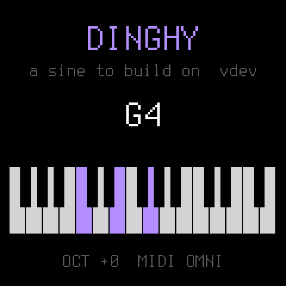

# Star Distroyer

A vector FM synth with a morphing resonator and multiband destruction, for the M-VAVE FM-1. Built on
[Dinghy](https://github.com/zvenson/dinghy) 0.4; everything below the line is Dinghy's README.

- Plans: [docs/sd/Star_Distroyer_FM1_Sound_Plan_v0.1.md](docs/sd/Star_Distroyer_FM1_Sound_Plan_v0.1.md) (the sound,
  the build order) and [docs/sd/Star_Distroyer_FM1_Sequencer_Plan_v0.2.md](docs/sd/Star_Distroyer_FM1_Sequencer_Plan_v0.2.md).
- Status: **V3, the voice, modelled on RYK Vector Wave** (P0, V1 and V2 are done). The engine is
  `firmware/src/sd_engine.h`, rendering in 32-frame sub-blocks.
  - Four banks of four oscillators: harmonics 1–32, roles C S P from left to right, FM = level × ENV2 × XM.
  - WP warps sine → triangle → saw → pulse, and FD folds.
  - The vector X/Y with VEC2, stereo per bank, and the modes MONO, DUO and POLY.
  - Gentle aliasing tracking.
  - Harmonic generators in `firmware/src/sd_gen.h`.
  - It plays from the keys, MIDI and a fixed 16-step loop.

  Controls (2026-11-07: the same on every page; the full map is at the top of `firmware/src/stardistroyer.c`):
  - A page button opens its page; pressed again, the next of its pages. The top line shows them, the current one
    a red tab: HOME VECTOR → MACROS; FX RIDER → DESTROY → SPACE; ENV ENV → FILTER; LFO LFO 1 → LFO 2 → MOD; ARP;
    SEQ SEQ A → SEQ B → TURING → back.
  - K1–K4: the four values in the row under the top line, left to right as the knobs (name, value, bar).
  - SCL held: their second layer (the names turn red). On SEQ and TURING the keys then transpose the track, taken
    at its next one.
  - ALGORITHM: the page's choice, on the hint line; SCL + ALGORITHM the second.
  - EDIT: ON / OFF of what the page shows (right of the top line; EDIT's light lit when on): VEC2, RIDER, DESTROY,
    SPACE, FILTER (the settings are kept), ARP, a track (SEQ B not in MONO), TURING.
  - PRESETS: the patch (a list while it turns); on SEQ and TURING the pattern. SELECT the tempo, GLO the mode,
    PLAY the patterns, REC recording, SAVE a user place.
  - The voices (MONO 1, DUO 2, POLY 4) are shared by rules: a playing track takes its widest chord (A first, then
    B), ARP one, the keys the rest, and no source turns off or takes another's note. What does not fit is refused
    or switched off with a short message: in MONO there is no ARP (and no keys but REC's) while SEQ A plays, and no
    SEQ B; a chord is recorded only as wide as the voices left. The status line shows who holds the voices (A B R -).
  - The keys remember what is held: a key let go gives its voice back to the latest key still down that lost it.
    In MONO: hold a note, play a second, let it go, and the first sounds again, legato (the pitch jumps back, the
    envelope goes on); in DUO and POLY a voice a new key took comes back the same way.
  - The key LEDs show what the keys do: the notes playing (and ARP's), on SEQ and TURING the steps of the bank,
    the black keys' actions (RND UNDO CLR, SEG on the last), and with SCL held the transpose.
  - The patches: GLASS BELL EPIANO GROWL ORGAN TOUR DISTROY VOWEL CHORDS PLUCKS FLANGE PHASER RIDE SPLIT COMET
    NEBULA PULSAR ION ORBITAL MONOLITH STRINGS, then the second cue's HALO AURORA TITAN DRIVE UNDERTOW IMPACT
    BRAAM SCREAM BEACON DEPTH SHARDS PRISM (`firmware/src/sd_patches.h`).

  The tables are generated: `python3 tools/gen_tables.py` writes `firmware/src/sd_tables.h`.
- The Rider (R1), modelled on RYK Night Rider:
  - Four filters after the voice (BP6, BP12, VBP; KP, AP1, AP2), through six stages by POS, with SLEW, a stage clock and
    key tracking.
  - FX opens its page: K1–K4 are POS RES SLEW DRIVE; with SCL held, FREQ MODEL DIV MIX.
  - R2 adds the models KP (combs), AP1 (delay allpasses) and AP2 (IIR allpasses).
  - R3 adds saturation inside the filters' loops, a level law (clean → drive → saturation) and a make-up per model.
  - Patches VOWEL, CHORDS, PLUCKS, FLANGE, PHASER and RIDE.
  - R4 makes it fill rather than replace: MIX keeps the dry whole up to the middle, LOW lets the lows skip it, and
    TRACK can snap the filters to the note's harmonics (HARM). `sd_render scene` plays a patch through a bass riff,
    a melody, POLY chords and an arpeggio. At MIX 0 it is off, and the patches from before sound as they
    did.
- DESTROY (D1), modelled on Ohm Force Ohmicide:
  - Four bands (LR4 or complementary), each with GAIN, BIAS, a shaper (NONE SOFT HARD FOLD CRUSH) with its ALT,
    LEVEL and PAN, then MIX.
  - FX, twice, opens its page: ALGORITHM picks the band, SCL + ALGORITHM its shaper.
  - D2 adds dynamics in each band: SHAPE from PHAT (a low-level compressor: quiet parts and tails come up) through
    off to SHARP (transients spit, tails shorter), and BODY, its threshold. With SCL held: K3 SHAPE, K4 BODY;
    MIX and XOVER are on LOOP with SCL held.
  - D3 adds a feedback loop (FB, TIME 1–20 ms, SPREAD), TAME (a lowpass that darkens it) and a safety limiter. They
    are on ALGORITHM's fifth step, LOOP.
  - Patch SPLIT. At MIX 0 it is off.
- SPACE (S1), last in the chain: a delay that feeds a reverb.
  - The delay is stereo or ping-pong, its TIME free (1 ms – 1 s) or a division of the beat (1/32 … 1/2, triplets,
    dotted), with FDBK and TONE.
  - The reverb is four diffusers into a four-line FDN, at half rate, with SIZE, DECAY and TONE; the echoes go into it.
  - FX, three times, opens its page: K1–K4 are TIME FDBK SIZE DECAY; with SCL held, D-LEVEL TONE R-LEVEL MODE.
  - Its memory (~195 KB) is the app's pool. Both levels at 0: no SPACE. Nine patches use it.
- The modulation (C1): one matrix for all four engines, and four macros.
  - Eight slots a patch: a source (ENV1 ENV2 LFO1 LFO2 VEC X VEC Y VEL KEY WHEEL AFTER RAND, and the engines
    themselves: STEP, SEGMENT, D LOW, D TOP, R STAGE, ECHO) onto a destination
    (PITCH XM WP FD DT X Y WIDTH; the Rider's POS FREQ RES DRIVE MIX; DESTROY's GAIN BIAS FDBK TAME MIX HIGH SPLIT; SPACE's
    FDBK D-LVL R-LVL DECAY) by an amount, −99 … +99 % of its range.
  - Two LFOs: SINE TRI SAW RAMP SQUARE S&H, 0.02–40 Hz or 1/16 … 4 bars synced, free, restarted by a note, or ONE:
    a single cycle from each note (a SAW: a ramp down inside the note). S&H glides ~10 ms into each step.
  - HOME: MUTATE (the voice's FM, warp, fold, detune), MOVE (a slow orbit of the vector, a sweep of the Rider's
    POS, width), BREAK (the Rider's drive, DESTROY's gain, ALT, bias, feedback, its level back) and MACRO 4 (BODY,
    AIR or DROWN, the patch's choice). 0 is the patch as programmed.
  - LFO opens MOD (LFO 1, LFO 2, the slots); HOME, pressed again, the macros. MIDI CC 1 is WHEEL and channel
    pressure AFTER.
  - All at the control rate, onto a copy of the patch each tick: no modulation, the sound sample for sample as
    before. `sd_render macros` plays the loop with each macro in turn.
- The sequencer (Sequencer Plan v0.3): a step sequencer like the stock FM-1's, with SkurkyMello's segments.
  - Up to 64 steps, each a NOTE (or SLIDE into it), a TIE, a REST or SKIPped, with its velocity and gate, RATCHET
    (2 or 3 hits, each softer, never closer than 50 ms) and PROB (the chance it plays); LENGTH,
    DIV (1/32 … 1/4, triplets), SWING. Segments A–F: REPEAT, ORDER (FWD REV P-P RND), SKIP, LENGTH, cut and joined
    on the white keys.
  - RND writes a new line in a scale on the first step's note. TURING (SEQ's third page, off by default; SkurkyMello's
    EVOLVE) rewrites CHANGE % of the steps at each loop's one, RANGE degrees either way or a rest (RESTS %), so a
    loop plays as it is and the next is a variation; CHANGE 0 is a locked loop; UNDO takes the last rewrite back.
  - REC: stopped, a key writes a step and moves on (ENV a tie, LFO a rest); playing, it writes the step playing.
  - SEQ opens its page; the pattern's default is the loop the engine played before, sample for sample.
- The filter (2026-11-06): a lowpass on each voice, LP12 or LP24, CUTOFF RES, ENV 3 (its own ADSR), KEY, VEL; off in
  every patch until it is turned on (ENV twice, EDIT).
- Two sequencer tracks on one sound (A and B: a melody and a bass line), chords in a step (keys held together under
  REC), and an arpeggiator (ARP: UP DOWN UP-DN RND ORDER, 1–4 octaves, RATE, GATE, HOLD).
- SAVE: 32 user patches (U01–U32) and 32 patterns (P01–P32) in flash, written once the sound is quiet.
  - **Other firmwares' saves:** on the FM-1 these live where the Felucca family keeps its data (the settings at
    0xFC000, the patches and patterns from 0x97000, `firmware/src/store.h`). Star Distroyer reads only its own
    (magic "SDST"); it cannot read another firmware's projects, and its first SAVE can overwrite them. Another
    firmware finds Star Distroyer's data foreign and may start fresh over it. Back up the flash (M-Flasher,
    MvaveFM1Unbricker) before switching if you want to keep either.
- STRINGS (P21): the cello, V4 (`tools/cello_v4.txt`, tuned by ear in the duo after a match to a recorded cello's
  scale; `tools/sd_strings.c` plays the scales and the duo). A plain saw with a slow bow and 8 cents of vibrato
  through the Rider's four BP6s snapped to the note's harmonics (the body), DESTROY as a four-band level, TAME, a
  small room. The tests check that STRINGS renders bit for bit as the file does.
- A cinematic demo: `tools/sd_cine.c` writes `build/audio/cine/star_distroyer_cine.wav` (~69 s, D minor, 84 BPM,
  original material) and each layer's stem: NEBULA's chords, TOUR's alien line, PULSAR's 16th ostinato, ION's bass,
  ORBITAL's drums, MONOLITH's drone and, with DISTROY, the braams of the climax; the macros step a bar at a time.
- The second film cue: `tools/sd_epic.c` writes `build/audio/epic/star_distroyer_epic.wav` (~127 s, E minor
  with a release into G major, 70 BPM, original material) and fifteen stems.
  - Every part plays a stock patch: STRINGS and the twelve after it in PRESETS are its sounds (HALO AURORA TITAN
    DRIVE UNDERTOW IMPACT BRAAM SCREAM BEACON DEPTH SHARDS PRISM). The tool adds only the notes, the macros' moves
    a bar, the cello's opening and the mix.
  - Three cellos (STRINGS) play the melody, a harmony and the roots. The melody starts filtered
    in a long hall and opens over eight bars.
  - NEBULA and GLASS give the chords and a choir. DISTROY gives horns and braams whose destroyed band falls through
    the spectrum on each hit.
  - ION (the ostinato and the bass) and ORBITAL drive, TOUR doubles the climaxes, and a sine sub holds the depth.
  - The first climax is in E minor, after a beat's silence. The last climax goes up a third, into G major, the
    release, and grows to its last bar under a rising and a falling arp.
- RANGE, the demo of the instrument's span: `tools/sd_range.c` writes `build/audio/range/star_distroyer_range.wav`
  (~135 s) and `performance.txt`, every gesture with its time and page. One FM-1 played by one person: one engine,
  one stock patch at a time, the app's controls only (a knob on its page, no faster than a hand turns it; the 27
  keys at velocity 100; MASTER ridden between scenes as the platform applies it), the voice rules checked every
  block (the tool stops at a gesture the FM-1 could not play). Seven scenes, a bar between them:
  - VECTOR (TOUR, MONO): VEC2, WARP and XM up, FOLD, a harmonic generator re-rolling bank A on each bar.
  - FILTER (GROWL): an acid line, the lowpass on, LP24, RES, ENV 3 short; TURING on, the line transposed at the ones.
  - RIDER (VOWEL, DUO): a melody on A, a bass on B transposed under it (D D Bb C); POS through the vowels, MODEL.
  - DESTROY (DISTROY, DUO): a riff in segments (RND, P-P), BREAK and MOVE up, the top band destroyed.
  - POLY (CHORDS): chords on A, the arpeggiator on top (HOLD), A up a tone with a new hand; UP-DN, 1/32, RND.
  - TURING (ORBITAL, MONO): an ostinato TURING rewrites, MOVE stepping the vector, MUTATE, the tempo to 124, 1/32.
  - SPACE (BEACON): long notes into the delay and the room, FDBK and DECAY up, a held key, the echoes falling.
- The song: `tools/sd_song.c` writes `build/audio/song/star_distroyer_song.wav` (~3:25) and `performance.txt`, under
  RANGE's rules (`tools/sd_play.h`, shared): one FM-1, one person, never more than one patch at a time, no layering.
  D minor at 112 BPM, one hook; the melody and the bass (or the chords and the hook) are the two tracks on the one
  patch, the harmony moving by the patterns and the transposes at the ones. Sections change without a stop where
  two patterns share their last bar; a bar's break only where the mode changes. INTRO (VOWEL, DUO: the bass, the hook
  from bar 5), VERSE, PRE (Bb Bb C C, BREAK up), CHORUS (CHORDS, POLY: Dm Bb F C with the root low on A, the hook on
  B), BRIDGE (ORBITAL, MONO: TURING, MOVE, MUTATE), BUILD (GROWL on the same line: the lowpass closes and opens),
  CHORUS (up a tone at bar 9), OUTRO (B off, the arpeggiator over the chords, the echoes, MASTER down, the arp alone).
- A demo: `tools/sd_demo.c` writes `build/audio/demo_star_distroyer.wav`, ~105 s at 100 BPM in D minor.
  - Five parts, each its own engine as the FM-1 plays one: a POLY pad through the AP2 phaser, KP plucks, GROWL's
    bass, a VOWEL then TOUR lead, and a break of DISTROY under sample-and-hold, a Lissajous vector and re-rolled
    harmonics.
  - The parts are layered as takes from a multitrack.
  - Only the mix is the tool's own.
- The screen follows the user's mockups in `docs/sd/ui/`: near black, ice-white lines, red accents, the "///" marks.
  - The boot shows a splash for 1.5 s: the logo, with stars streaming past and one shooting across.
  - Every page is laid out the same (2026-11-07): the logo and the patch's number; the patch as a red tab, the
    bank's roles, the mode; the button's pages with EDIT's ON / OFF; K1–K4 in a row; the picture of what they set
    (the vector's diamond and the bank's oscillators, the Rider's peaks and stages, DESTROY's bands, the echoes,
    the envelopes, the filter's response, an LFO's cycle, the matrix's slots, the arpeggio, the steps); the hint
    (what ALGORITHM does); the steps playing; tempo, octave, ARP and the load.
  - Each region is drawn 25 times a second and sent to the screen only when its pixels changed.
  - No keyboard on the screen: the key LEDs show what the keys do (above).
  - The logo is traced from the mockup: its own letters as a clean mask in the screen's ICE and RED (no shading),
    the bars on whole pixels at each size: `python3 tools/gen_logo.py` (Pillow) writes `firmware/src/sd_logo.h`
    and `build/logo_preview.png`.
- The loop of work:

  ```sh
  tests/run_sd.sh                              # engine tests, build/audio/*.wav to listen to, the host bench
  tests/run_host.sh tests/scripts/q1.txt       # the whole firmware on the host: WAV + screens (q2: saving)
  ./build.sh                                   # -> build/stardistroyer.fwsc (identity FM-1_96200; a release X.Y: FM-1_962XY)
  tools/emu_cpu.sh build/stardistroyer.fwsc    # the chip's load in fm1-emu
  ```

- Departures from Dinghy 0.4's own files: `firmware/src/gfx.c` (the canvas without a `.pool` section on a macOS host);
  `firmware/hal/fm1_flash_map.h` takes Dinghy's later fix (f77bf03): the newer FM-1s' flash, the UC25HQ80
  (0xB36014), beside the first units' 0x856014, in the app and the update loader (without it they save to RAM only
  and every update fails); `tools/build.py`: the identity FM-1_962XY.

---

<p align="center"></p>

# Dinghy

**The smallest firmware for the M-VAVE FM-1 to build your own on.**

Dinghy plays a sine wave on the keys, and that is all it does. Under it is everything an FM-1 firmware needs
before it can be any fun: the update path, the USB rescue, MIDI over USB and the TRS jack (with clock), USB audio, the
keys, knobs and LEDs, the screen, flash storage, and the same again for the M-Vave SMK-37. It all works, so you start
with the part you actually want to write.

```
firmware/src/dinghy.c     <- your firmware: ~300 lines, a 4-voice sine. Start here.
firmware/src/platform.c   <- the plumbing (boot, USB, MIDI, updates, audio ISR, storage). Done; read it, don't fight it.
firmware/src/store.h      <- where your data lives in flash, per board
firmware/src/*.c, hal/    <- Felucca's platform, as SLOOP / sloopDX / OberVave carry it; the SMK-37 layer
```

Dinghy is based on [Felucca](https://github.com/hugelton/Felucca) by Leo Kuroshita (Hügelton Instruments), with its
platform as [SLOOP](https://github.com/isod89/sloop-fm1) (isod89) carries it: it keeps that platform and throws away the
rest. The smallest boat of the family, after the felucca and the sloop.

<p align="center"></p>

> **Status: 0.4.** 0.3 was tested on the FM-1: the install, MIDI in (pitch exact, 4 voices), USB audio at
> 44.1 / 48 kHz, the keys, the screen, the octave kept in flash, and back to another firmware through the hub.
> 0.4 brings OberVave's platform over: the TRS MIDI IN, the clock, blobs and slots, the loader's screen, the SMK-37.
> That code runs on the device in OberVave (FM-1 and SMK-37); Dinghy 0.4 itself is tested on the host only so far.

## What you get

| | |
| --- | --- |
| **Updates that always work** | `tools/fm1_install.py`, the web installers and the [FM-1 Firmware Hub](https://thefirmwarehub.com) reach your firmware over USB, so you (and your users) can always install the next build, or go back to the official firmware. |
| **USB rescue** | Hold **OCT-** while switching on: no sound, only the updater. If your firmware crashes twice at boot, the FM-1 goes there by itself. |
| **MIDI** | USB in and out (class compliant) and the FM-1's TRS MIDI IN, in one queue: `midi_get()` says where a message came from, `midi_send()`. Clock, start, stop and continue reach your app. |
| **USB audio** | The FM-1 shows up as a 16-bit stereo audio input (44.1 or 48 kHz): record it into any DAW or phone. Nothing to do. |
| **Panel** | 27 keys, 14 buttons, 7 encoders, the MASTER knob, the LEDs, by name (`BTN_PLAY`, `ENC_KNOB1`, ...). |
| **Screen** | 240 x 240, text in two sizes, rectangles, lines, pixels. |
| **Storage** | `settings_*` (4 KB), 8 blobs of 4 KB (`blob_*`), 8 slots of 16 KB (`slot_*`), each with a CRC, in places no other part of the flash is in reach of. |
| **Never waits for the screen** | `LCD_IDLE`: your app reads MIDI and the keys while the screen's DMA runs, so a chord never stumbles over a redraw. |
| **The SMK-37 too** | `./build.sh --board smk37` (Pro, Elite, MKE-P37): the same app on M-Vave's 37-key keyboard, with velocity, outer keys, 16 coloured pads, faders and wheels. [docs/SMK37.md](docs/SMK37.md) |
| **An update screen** | The update loader draws your name in your colour, a progress bar and what to do, also after an install was cut off (FM-1). |
| **A crash screen** | A fault shows where it happened (the PC), then the FM-1 restarts. |
| **Host mode** | The same `dinghy.c` on your computer: the screen as an image, the sound as a WAV, scripted keys, knobs, MIDI (USB and TRS, a clock), SMK-37 pads and wheels. No FM-1 needed to try an idea. |
| **Tests and CI** | `tests/run_tests.sh`: the host app, the flash maps, the update path, the loader, the installer. A tag `vX.Y` on GitHub builds, tests and releases the packages with a build attestation. |
| **Checks** | The build fails on what bricks or breaks an FM-1 firmware: a 64-bit division, a call into the chip ROM, too much RAM, a register touched outside `hal/`. |

## Build your own

From nothing to your own firmware on the FM-1, step by step. Each step works before you go to the next.

### 1. Copy it

On GitHub: **Use this template** (top right on this page) or fork it, then clone your copy. Rename nothing yet:
first make sure the unchanged Dinghy builds on your machine.

### 2. Set up once

You need Linux on x86-64 (or macOS / Windows with Docker or WSL), Python 3 with Pillow, the JieLi toolchain
and three files of the JieLi AC79 SDK:

```sh
pip3 install Pillow mido python-rtmidi
tools/get_toolchain.sh                      # JieLi's clang for the chip, to ~/.jieli/toolchain
git clone --depth 1 --branch AC79NN_SDK_V1.2.1_2023-12-13 \
    https://gitee.com/Jieli-Tech/fw-AC79_AIoT_SDK.git ~/fw-AC79_AIoT_SDK
```

On macOS the build runs the toolchain in a `linux/amd64` Docker container by itself (have Docker running).
`JIELI_TOOLCHAIN` and `AC79_SDK` point elsewhere if your copies live somewhere else.

### 3. Hear it without an FM-1

```sh
tests/run_host.sh                           # -> build/host/dinghy.wav and screen PNGs
```

Host mode runs the same `dinghy.c` on your computer: the sound as a WAV, the screen as images. Most ideas can be
tried here first, in seconds.

### 4. Your first change

Open [firmware/src/dinghy.c](firmware/src/dinghy.c) (~200 lines). The sound is `app_audio()`: it gets an empty
buffer of stereo frames and adds to it. Make the sine a square:

```c
s = ((int32_t)ph < 0 ? 8000 : -8000) * amp >> 15;     /* instead of s = (sine(ph) * amp) >> 15; */
```

Run `tests/run_host.sh` again and listen to `build/host/dinghy.wav`. The screen is drawn in `app_main()`, the keys
are read there too: change the text, add a knob ([docs/API.md](docs/API.md) has every call).

### 5. Onto the FM-1

```sh
./build.sh                                       # -> build/dinghy.fwsc (fails on what would brick the FM-1)
python3 tools/fm1_install.py build/dinghy.fwsc   # over USB; asks before it writes, restarts into your build
python3 tools/fm1_install.py --info              # what runs on the connected FM-1
```

That is the whole loop: change, hear it on the host, build, install. Back to another firmware, or to the official
one, with the [FM-1 Firmware Hub](https://thefirmwarehub.com) in Chrome or Edge: Dinghy (and every copy of it)
answers the hub's updater like every firmware there. Installing firmware is at your own risk.

### 6. When it goes wrong

- **It crashes:** the screen shows where (the PC), then the FM-1 restarts. Twice at boot and it goes to the
  USB rescue by itself.
- **It won't start at all:** hold **OCT-** while switching on: the USB rescue, no sound, only the updater. Install
  a working build (or another firmware from the hub) from there.
- **The build refuses:** it checks for a 64-bit division, a call into the chip ROM, too much RAM, a register touched
  outside `hal/`. [docs/RULES.md](docs/RULES.md) says why each one matters; read it before your first crash.

### 7. Make it yours, release it, get into the hub

Your name and logo, your own package identity (so the FM-1 and the installers tell your firmware from Dinghy),
a GitHub release with the `.fwsc`, and how to get listed next to the others in the
[FM-1 Firmware Hub](https://thefirmwarehub.com): **[docs/MAKE-IT-YOURS.md](docs/MAKE-IT-YOURS.md)**.

## Where to go next

- **[docs/API.md](docs/API.md)**: everything `platform.c` gives you, with the panel's ids, the screen calls, the
  audio contract, MIDI, storage, the flash map, timing, the SMK-37.
- **[docs/SMK37.md](docs/SMK37.md)**: building and installing for the M-Vave SMK-37.
- **[docs/MAKE-IT-YOURS.md](docs/MAKE-IT-YOURS.md)**: turn Dinghy into your firmware: the name, the package
  identity, releases, getting into the FM-1 Firmware Hub.
- **[docs/RULES.md](docs/RULES.md)**: the chip's rules (no FPU, no libgcc, the audio ISR's budget) and what the build
  checks for you. Read it before your first crash, not after.

## License

GPL-3.0-only, as Felucca and SLOOP: you may change and share it, and whoever gets your firmware gets its source.
Details, credits and third-party parts in [LICENSING.md](LICENSING.md).

The platform is Copyright (C) 2026 Leo Kuroshita (@kurogedelic), Hügelton Instruments, with SLOOP's changes (isod89);
the SMK-37 layer by M. Geisler (genkigenki); the loader's screen after Skiff (illuminus5). Dinghy (the app, the host
mode, the docs) by zvenson.
