<p align="center">
  
</p>

<p align="center">
  <b>A starship FM synth for the M-VAVE FM-1.</b><br>
  Four banks of oscillators on an X/Y nav field · a morphing resonator · multiband destruction · delay and room
</p>

<p align="center">
  
  
  
  
</p>

<p align="center">
  <a href="https://joakimskurk.github.io/fm1stardistroyer/"><b>The page: hear it, play it in the browser, and install it →</b></a>
</p>

<p align="center">
  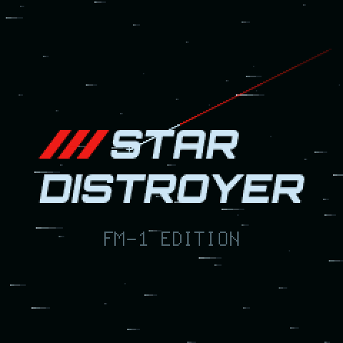
  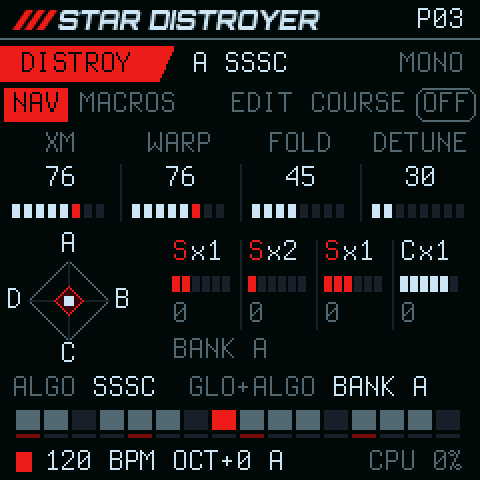
  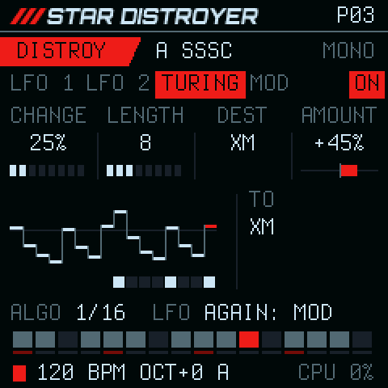
</p>

Star Distroyer turns the FM-1 into one instrument with four engines in a row. A **voice** of sixteen oscillators,
morphed across an X/Y field; a **Reactor** of four resonators that sweep through vowels, chords and combs; **DESTROY**,
which splits the sound into four bands and wrecks each its own way; and **SPACE**, a delay feeding a room. Around them
are a modulation matrix with a Turing machine, four macros, a two-track step sequencer with segments, and an
arpeggiator. 29 patches come with it, and 32 places of your own.

> **Status:** in development. Everything here runs on the host (the same C, the sound as WAV, the screen as images)
> and in the FM-1 emulator. It has **not yet been tested on a real FM-1**, and there is no release yet.

<p align="center">
  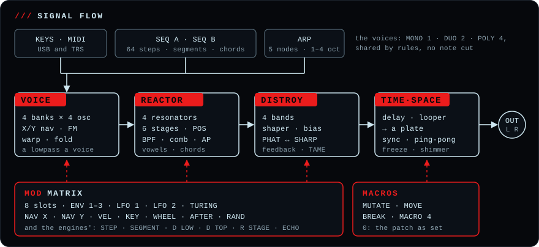
</p>

##  The sound

<table>
<tr>
<td width="264" valign="top"></td>
<td valign="top">

**VOICE**: four banks of four oscillators.
- Each oscillator is a harmonic 1–32 of the note with a fine tune, and a carrier or a modulator (series or
  parallel), read left to right.
- **XM** sets the FM, **WARP** turns sine → triangle → saw → pulse, **FOLD** folds, **DETUNE** spreads.
- The **NAV** X/Y blends the four banks. **COURSE** plays four stored X/Y cells from each note.
- Harmonic generators re-roll a bank: ALL, ODD, RND, CLUST, CHRD (14 chords), CPY.
- **MONO**, **DUO** or **POLY**, a bank's own stereo place by WIDTH, and gentle aliasing tracking up high.

</td>
</tr>
<tr>
<td valign="top">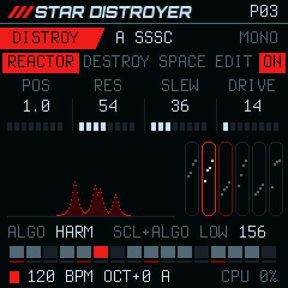</td>
<td valign="top">

**REACTOR**: a quad morphing resonator after the voice.
- Four filters of one model: BP6, BP12, a variable BPF, KP combs, delay allpasses (AP1) or IIR allpasses (AP2).
- Six stages hold every filter's pitch and level. **POS** moves through them, and **SLEW** jumps or glides.
- A stage clock (forwards, backwards, ping-pong, random) and key tracking. **HARM** snaps the filters to the note's
  harmonics.
- **MIX** keeps the dry voice whole up to the middle, and **LOW** lets the lows pass by. At 0 it is not there.

</td>
</tr>
<tr>
<td valign="top">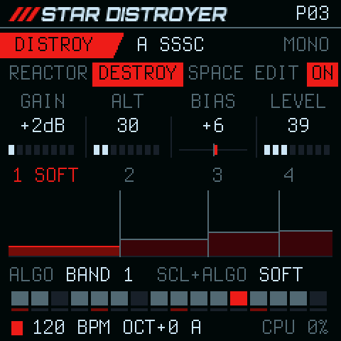</td>
<td valign="top">

**DESTROY**: multiband destruction.
- Four bands (LR4 or complementary crossovers), each with **GAIN**, **BIAS**, a shaper (NONE SOFT HARD FOLD CRUSH)
  and its **ALT**, **LEVEL** and **PAN**.
- Dynamics in each band: **PHAT** lifts quiet parts and tails, **SHARP** spits transients, and **BODY** sets where.
- A feedback loop (1–20 ms, spread) with **TAME** to darken it, and a safety limiter so it never blows up.

</td>
</tr>
<tr>
<td valign="top">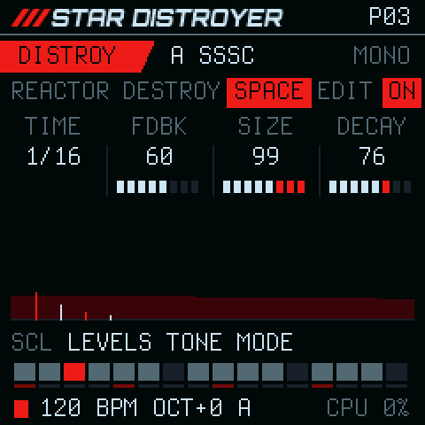</td>
<td valign="top">

**SPACE**: a delay into a room, last in the chain.
- Stereo or ping-pong, free (1 ms – 1 s) or on the beat (1/32 … 1/2, triplets, dotted), with **FDBK** and **TONE**.
- The room is four diffusers into a four-line network, with **SIZE**, **DECAY** and **TONE**. The echoes go into it.

</td>
</tr>
<tr>
<td valign="top">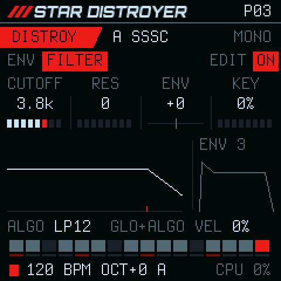</td>
<td valign="top">

**ENV and FILTER**
- **ENV 1** shapes the level and **ENV 2** the FM amount.
- A lowpass on each voice, LP12 or LP24, with **CUTOFF**, **RES**, its own envelope (ENV 3), key and velocity. It is
  off until you turn it on.

</td>
</tr>
</table>

##  Movement

<table>
<tr>
<td width="264" valign="top">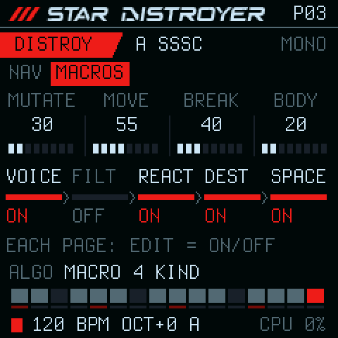</td>
<td valign="top">

**Four macros** on HOME. 0 is the patch as programmed.
- **MUTATE**: the voice's FM, warp, fold and detune.
- **MOVE**: the nav in orbit or jumping on the beat, the Reactor's POS, the width.
- **BREAK**: the Reactor's drive and DESTROY's gain, ALT, bias and feedback, the top bands first.
- **MACRO 4**: BODY, AIR or DROWN, as the patch chooses.

</td>
</tr>
<tr>
<td valign="top">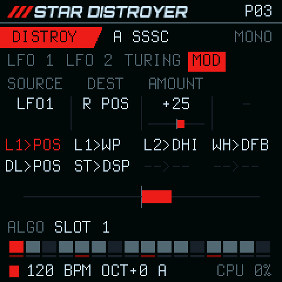</td>
<td valign="top">

**The modulation matrix**: eight slots a patch, from a source onto a destination by −99 … +99 %.
- **Sources:** ENV 1, ENV 2, LFO 1, LFO 2, TURING, NAV X, NAV Y, VEL, KEY, WHEEL (CC 1), AFTER (channel pressure) and
  RAND. The engines feed it too: STEP, SEGMENT, D LOW, D TOP, R STAGE and ECHO.
- **Destinations:** across all four engines, from PITCH and XM to the Reactor's POS, DESTROY's SPLIT and SPACE's DECAY.
- **Two LFOs:** SINE TRI SAW RAMP SQUARE S&H, free (0.02–40 Hz) or synced (1/16 … 4 bars), restarted by a note, or
  ONE cycle a note.

</td>
</tr>
<tr>
<td valign="top"></td>
<td valign="top">

**TURING**, on LFO after the two LFOs: a Turing machine, a modulation source of the patch. Off until you switch it on.
- A loop of **LENGTH** bits (2–16) steps on the tempo (ALGORITHM: 1/32 … 1/4). As each bit comes round, **CHANGE**
  is the chance it flips: 0 locks the loop, a little lets it drift, 100 plays it and its inverse.
- Its 8 newest bits are the output: a stepped value, every step a new one.
- **DEST** and **AMOUNT** send it anywhere the matrix can, XM by default. **NOTES** moves SEQ A's notes in the
  pattern's scale as they play, and never rewrites the pattern. In MOD it is a SOURCE too, for more places.

</td>
</tr>
</table>

##  Playing it

<table>
<tr>
<td width="264" valign="top">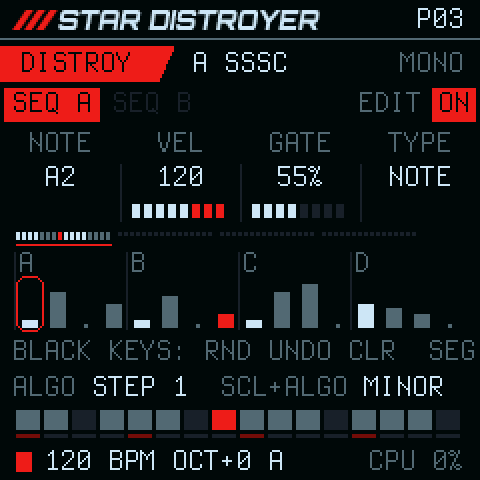</td>
<td valign="top">

**Two sequencer tracks on one sound**: a melody on A and a bass line on B, one tempo and one PLAY.
- Up to 64 steps: NOTE (or a SLIDE into it), TIE, REST or SKIP. Each has velocity, gate, **RATCHET** (2 or 3 hits)
  and **PROB**, and can hold a chord of up to four notes.
- **Segments A–F:** the pattern cut on the white keys, each with REPEAT, ORDER (forwards, reverse, ping-pong,
  random), SKIP and LENGTH.
- **REC** records from the keys: stopped, step by step; playing, into the step that plays.
- **SCL held** transposes a track from the keys, taken at its next one.

</td>
</tr>
<tr>
<td valign="top">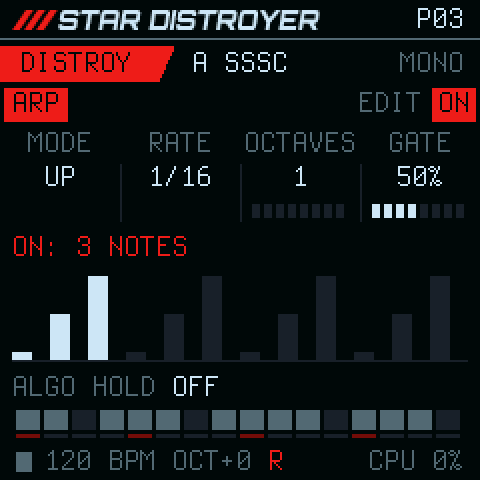</td>
<td valign="top">

**ARP**: UP, DOWN, UP-DN, RND or ORDER over 1–4 octaves, RATE 1/32 … 1/4, GATE and HOLD, on the tempo.

**The voices are shared by rules.** MONO has 1, DUO 2, POLY 4. A playing track takes its widest chord, ARP takes one,
and the keys take the rest. No source cuts another's note. What does not fit is refused with a short message.

The keys remember what is held: in MONO, hold a note, play a second and let it go, and the first sounds again,
legato.

</td>
</tr>
</table>

### The controls

Every page is laid out the same: its button's pages on the top line (the current one a red tab, EDIT's ON / OFF on the
right), K1–K4 as four boxes in a row like the knobs, the picture, the hint line, the steps and the status. The key
LEDs show what the keys do.

| Control | What it does |
| --- | --- |
| **HOME** | NAV → MACROS |
| **FX** | REACTOR → DESTROY → SPACE |
| **ENV** | ENV → FILTER |
| **LFO** | LFO 1 → LFO 2 → TURING → MOD |
| **ARP** | the arpeggiator |
| **SEQ** | SEQ A → SEQ B |
| **K1–K4** | the four values in the row on top |
| **SCL** held | the second layer (the names turn red); on SEQ, the keys transpose the track |
| **ALGORITHM** | the page's choice, named on the hint line; SCL + ALGORITHM the second |
| **EDIT** | ON / OFF of what the page shows: COURSE, REACTOR, DESTROY, SPACE, FILTER, ARP, a track, TURING |
| **PRESETS** | the patch; on SEQ the pattern |
| **SELECT** · **GLO** | the tempo (40–240 BPM) · MONO → DUO → POLY |
| **PLAY** · **REC** · **SAVE** | the sequencer · recording · a place of your own (32 patches, 32 patterns) |

The whole map is at the top of [`firmware/src/stardistroyer.c`](firmware/src/stardistroyer.c).

##  The patches

<p align="center">
<code>GROWL</code> <code>VOYAGE</code> <code>DISTROY</code> <code>VOWEL</code> <code>CHORDS</code> <code>PLUCKS</code> <code>FLANGE</code> <code>PHASER</code> <code>FUSION</code> <code>SPLIT</code><br>
<code>COMET</code> <code>NEBULA</code> <code>PULSAR</code> <code>ION</code> <code>ORBITAL</code> <code>MONOLITH</code> <code>STRINGS</code> <code>HALO</code> <code>AURORA</code> <code>TITAN</code><br>
<code>DRIVE</code> <code>UNDERTOW</code> <code>IMPACT</code> <code>BRAAM</code> <code>SCREAM</code> <code>BEACON</code> <code>DEPTH</code> <code>SHARDS</code> <code>PRISM</code>
</p>

DISTROY is the one it starts on: everything at once.

Two patches start from a plain FM sound and carry the Star Distroyer edge: the body stays as it was, only the top
band is destroyed, and something steps on the beat.
- **GROWL:** its top is destroyed in time with its fold.
- **AURORA:** a glass pad, its top folded to a sheen that takes a new depth each bar.

The patches live in [`firmware/src/sd_patches.h`](firmware/src/sd_patches.h).

##  Install

There is no release yet. [The page](https://joakimskurk.github.io/fm1stardistroyer/) installs the latest build of
`main` from the browser (Chrome or Edge, over USB MIDI); or build the package yourself (below) and install it with
`tools/fm1_install.py`. Either way, installing it is on you.

1. **Back up your FM-1's flash first**, with M-Flasher or MvaveFM1Unbricker. Star Distroyer saves where the Felucca
   family keeps its data (settings at 0xFC000, patches and patterns from 0x97000). It reads only its own saves, and
   its first SAVE can overwrite another firmware's projects.
2. Install it from [the page](https://joakimskurk.github.io/fm1stardistroyer/#install), or the package over USB:

   ```sh
   pip3 install mido python-rtmidi
   python3 tools/fm1_install.py build/stardistroyer.fwsc     # it asks before it writes
   ```

3. **The way back:** install any firmware from the FM-1 Firmware Hub, or hold **OCT−** while switching on for the USB
   rescue.

The package accepts both FM-1 flash chips: the first units' Puya P25Q80 (0x856014) and the UC25HQ80 (0xB36014) in
units sold since autumn 2026. A development build identifies as `FM-1_96200`, a release X.Y as `FM-1_962XY`.

##  Build from source

The toolchain, the JieLi SDK and the host mode are as Dinghy sets them up:
[docs/DINGHY.md](docs/DINGHY.md#2-set-up-once).

```sh
tests/run_sd.sh                              # the engine's tests (also under ASan/UBSan) and the renders
tests/run_host.sh tests/scripts/q1.txt       # the whole firmware on the host: a WAV and the screens
./build.sh                                   # -> build/stardistroyer.fwsc
tools/emu_cpu.sh build/stardistroyer.fwsc    # the chip's load in fm1-emu
sh tests/run_tests.sh                        # the update path, the loader, the installer, the flash maps
sh web/app/build.sh                          # the player: the firmware as WebAssembly (clang + lld, wasm32)
node tests/web_test.mjs build/web/stardistroyer.wasm   # ... boots, plays, turns pages, saves
```

The page's player (`web/app/`) is the same `firmware/src/stardistroyer.c`, built on `web/app/web_host.c` (an FM-1 for
the browser, as `tests/host.c` is one for a computer) instead of the chip: no imports, no C library. It runs in the
page's audio thread (`worklet.js`), its main loop a pass for each millisecond its sound is worth; `player.js` draws
the FM-1's panel around its screen. Without a wasm32 clang here, any Docker image with clang and lld builds it:
`docker run --rm -v "$PWD":/w -w /w IMAGE sh web/app/build.sh`.

`tests/run_sd.sh` also renders the demos into `build/audio/`. Each is played the way one person plays one FM-1: a
stock patch, the app's own controls and the voice rules.
- **DERELICT** (`derelict/`, ~1:41, C minor at 84 BPM): an overture of four themes in four-bar turns, four such
  passes on one FM-1 layered, never more than four at once, with each pass's stem and every gesture in
  `performance.txt`.
- **The song** (`song/`, ~3:25, D minor at 112 BPM).
- **RANGE** (`range/`, ~135 s): the instrument's span in seven scenes, with every gesture listed in
  `performance.txt`.
- **CINEMATIC** (`cine/`, ~69 s, D minor at 84 BPM): a cue, eight parts layered as a multitrack, with their stems.
- The second cue (`epic/`, its parts layered as engines, with its stems), and the loops of the identity patches.

Screens and banner: `tools/make_readme_art.sh`. The logo comes only from `tools/gen_logo.py`.

##  Under the hood

- **Integers only:** fixed point throughout, no float and no 64-bit division in the audio. It renders in 32-frame
  sub-blocks inside the FM-1's audio interrupt, with modulation at the control rate.
- **CPU:** in fm1-emu, DISTROY's loop takes **40.7 %** of the chip (POLY with SEQ and ARP: 44 %). The budget is under
  half, as Dinghy's [rules](docs/RULES.md) ask, because USB, the key scan and the screen need the rest. The emulator
  counts instructions, not cycles, so the real chip has the last word.
- **Generated:** the oscillator's laws are tables from `tools/gen_tables.py`.
- **The plans:** [the sound](docs/sd/Star_Distroyer_FM1_Sound_Plan_v0.1.md) and
  [the sequencer](docs/sd/Star_Distroyer_FM1_Sequencer_Plan_v0.2.md), with every step's measurements.
- **The platform's docs:** [API](docs/API.md), [rules](docs/RULES.md), [SMK-37](docs/SMK37.md) and
  [make it yours](docs/MAKE-IT-YOURS.md).
- **Departures from Dinghy 0.5's own files:**
  - `firmware/src/gfx.c`: the canvas without a `.pool` section on a macOS host and in the browser.
  - `firmware/src/platform.c`: with `DINGHY_WEB`, the browser's FM-1 (`web/app/web_host.c`) in place of `tests/host.c`.
  - `firmware/hal/fm1_flash_map.h`: a build-time check that both FM-1 flash parts pass.
  - `tools/build.py`: the identity FM-1_962XY.
  - `.github/workflows/release.yml`: it also runs on every push to `main`, and publishes the page (`web/`) with the
    player built and tested.

##  Credits and licence

Star Distroyer is by [joakimskurk](https://github.com/joakimskurk). It is built on
[Dinghy](https://github.com/zvenson/dinghy) by zvenson, which is based on
[Felucca](https://github.com/hugelton/Felucca) by Leo Kuroshita (Hügelton Instruments), with its platform as
[SLOOP](https://github.com/isod89/sloop-fm1) (isod89) carries it. The logo's letters are
[Orbitron](https://github.com/theleagueof/orbitron) (The League of Moveable Type, SIL Open Font License). Who made
which part is in [LICENSING.md](LICENSING.md).

GPL-3.0-only: you may change and share it, and whoever gets your firmware gets its source. "M-VAVE" and "FM-1"
belong to their owners. Star Distroyer is not made or endorsed by them.
