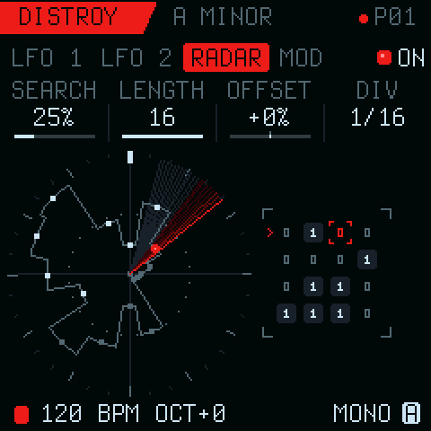
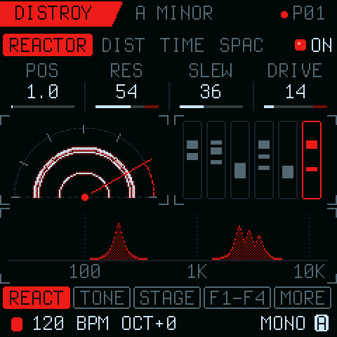
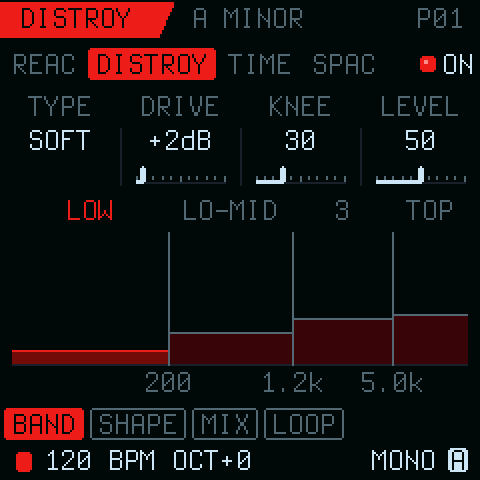
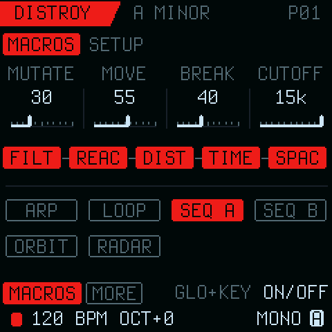
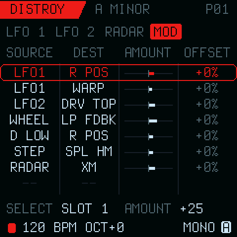
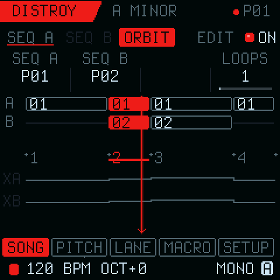
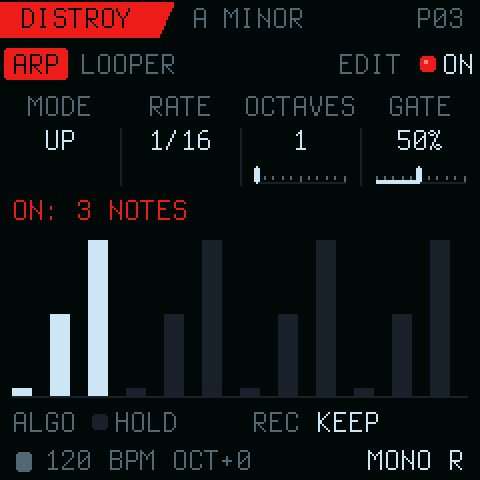

<p align="center">
  
</p>

<p align="center">
  <b>A starship FM synth for the M-VAVE FM-1.</b><br>
  Four banks of oscillators on an X/Y nav field · a morphing resonator · multiband destruction · delay and room
</p>

<p align="center">
  
  
  
  
</p>

<p align="center">
  <a href="https://joakimskurk.github.io/fm1stardistroyer/"><b>The page: hear it, play it in the browser, and install it →</b></a>
</p>

<p align="center">
  
  
  
</p>

Star Distroyer turns the FM-1 into one instrument with four engines in a row. A **voice** of sixteen oscillators,
morphed across an X/Y field; a **Reactor** of four resonators that sweep through vowels, chords and combs; **DISTROY**,
which splits the sound into four bands and wrecks each its own way; and **TIME** and **SPACE**, a delay and a looper
feeding a plate. Around them
are a modulation matrix with RADAR (a loop of random steps), four macros, a two-track step sequencer with segments, and an
arpeggiator. 29 patches come with it, and 32 places of your own.

> **Status:** the second beta, [0.3-beta](https://github.com/joakimskurk/fm1stardistroyer/releases/tag/v0.3-beta). Each version is
> played on an FM-1, and everything here also runs on the host (the same C, the sound as WAV, the screen as images) and
> in the FM-1 emulator. Install it only if you are ready to take the way back (Install, below). What you save
> may not load in the next beta: the saves can change until 1.0.

<p align="center">
  
</p>

##  The sound

<table>
<tr>
<td width="264" valign="top"></td>
<td valign="top">

**VOICE**: four banks of four oscillators.
- Each oscillator is a harmonic 1–32 of the note with a fine tune, and a carrier or a modulator (series or
  parallel), read left to right.
- **XM** sets the FM, **WARP** turns sine → triangle → saw → pulse, **FOLD** folds, **DETUNE** spreads.
- The **NAV** X/Y blends the four banks. **COURSE** travels four stored X/Y cells (MONO): EDIT on NAV turns it
  **ON** (from each note, once round, held on the last), **LOOP** (round and round on its own, back to the first;
  a note does not start it again, PLAY does, in time with the sequencer) or OFF.
- Harmonic generators re-roll a bank (K4 of NAV's X/Y layer): ALL, ODD, RND, CLUST, 14 chords, CPY, from a list as the knob
  turns, each with the harmonics it sets.
- **MONO**, **DUO** or **POLY**, the banks spread by WIDTH round the middle of what sounds (never more than 6 dB to a
  side; a corner's bank alone in the middle), and gentle aliasing tracking up high.

</td>
</tr>
<tr>
<td valign="top"></td>
<td valign="top">

**REACTOR**: a quad morphing resonator after the voice.
- Four filters of one model: BP6, BP12, a variable BPF, KP combs, delay allpasses (AP1) or IIR allpasses (AP2).
- Six stages hold every filter's pitch and level. **POS** moves through them, and **SLEW** jumps or glides.
- A stage clock (forwards, backwards, ping-pong, random) and key tracking. **HARM** snaps the filters to the note's
  harmonics.
- **MIX** keeps the dry voice whole up to the middle, and **LOW** lets the lows pass by. At 0 it is not there.
- In a patch without it, **EDIT** turns it on with six vowels on POS (A, E, EE, AW, OO, ER), so the knobs are heard
  at once.
- Its layers (ALGORITHM): **REACT** (POS RES SLEW DRIVE), **TONE** (FREQ MODEL DIV MIX), **STAGE**, **F1-F4** and
  **MORE** (TRACK, LOW, and **STAGES**, how many it uses, 1 to 6: POS's whole turn and the stage clock then go through
  those only, at 1 a monosynth's fixed body, nothing to copy).
- **STAGE** edits what each stage holds: it opens on the stage POS is on, the one you hear; SELECT picks another (POS goes there, so you hear it), **K1
  TYPE** puts one of 13 vowels or 18 chords in it from a list (2026-11-23: MAJ9, MIN11, the dark PHRYG, a CLUSTER and SUS24 too), **K2 PITCH** moves it, **K3 WIDTH** spreads or closes
  it, **K4 LEVEL**; **F1-F4** its four filters one by one. The keys play all the while. SAVE keeps it with the patch.
- The picture: the filters as peaks across the frequency range, and under them the six stages as a piano roll, each
  its four filters as notes at their pitch, the one playing red; a stage not in use is a dotted frame.

</td>
</tr>
<tr>
<td valign="top"></td>
<td valign="top">

**DISTROY**: multiband destruction.
- Four bands, LOW, LO-MID, HI-MID and TOP (LR4 or complementary crossovers). SELECT picks one, framed red in the
  picture.
- Its layers (ALGORITHM): **BAND**, the band's **TYPE** (NONE SOFT HARD FOLD CRUSH), **DRIVE**, what the type does
  (**KNEE**, **SPACING** or **DEPTH**) and **LEVEL**; **SHAPE**, its **BIAS**, **PAN**, **DYNAMIC** and **BODY**;
  **MIX**, its **SPLIT** (its upper edge, in Hz), the crossover (**XOVER**) and the whole's **MIX**; **LOOP**, the
  feedback loop's FDBK TIME SPREAD TAME.
- Dynamics in each band: **PHAT** lifts quiet parts and tails, **SHARP** spits transients, and **BODY** sets where.
- HI-MID and TOP are shaped at twice the rate (2026-11-19), so SOFT, HARD and FOLD up high no longer fold back as
  noise: a HARD top at 3 kHz leaves −44 dB of it where it left −21 (CRUSH keeps its grit on purpose).
- **The levels** (2026-11-21): DRIVE shapes the sound and adds only a little level. Turned from 0 to the top, a band
  grows by about +1 to +3 dB, all four together by about +5. Before, that was +7 to +15 dB, and the master limiter then
  ducked everything. The Reactor's DRIVE past 1x and RES on BP6 and BP12 hold back the same way. DISTROY's own safety
  limiter lets go in 0.2 s instead of 0.75. The factory patches play at the same loudness as each other (they spread
  over 30 dB before), and they sound as they did. Your own saved patches keep their sound too: only the knobs' travel
  is new.
- The picture: the bands on a frequency axis, as tall as their drive, the splits in Hz under them. EDIT on a patch
  with no bands yet sets four that sound.
- A feedback loop (1–20 ms, spread) with **TAME** to darken it, and a safety limiter so it never blows up.

</td>
</tr>
<tr>
<td valign="top"></td>
<td valign="top">

**TIME** and **SPACE**: a delay and a looper into a plate, last in the chain (FX: REACTOR, DISTROY, TIME, SPACE; the looper on ARP, beside the arpeggiator).
- **TIME** is the delay: stereo or ping-pong, free (1 ms – 1 s) or on the beat (1/32 … 1/2, triplets, dotted), with
  **FDBK**, **TONE** and **D-LEVEL**; its **MODE** layer: **FREE** or **SYNC**, and **PING**-pong. Ping-pong comes in pairs: an echo on the left, then one as
  loud on the right. On the beat it stays on the beat: a division longer than its 1 s (1/2 under 120 BPM, 1/4D under
  90) plays at half, 1/2 as 1/4 and 1/4D as 1/8D. TIME turns red and the hint line says what plays. TIME always
  turns from what plays (2026-11-23): up the next longer division that fits, down the next shorter, so turning it is
  always shorter one way and longer the other, never a jump back.
- The **looper** (its own page, **LOOPER**, ARP's second: **LOOP**, **LENGTH**, **SPEED**, **L-LEVEL**; EDIT arms it; EDIT again, or LOOP's switch on HOME, turns it off with its loop **KEPT** (the top line says KEPT): it fades out, stops recording, and comes back the same when switched on; **CLEAR** on its **TOOLS** layer clears it, asked, OCT+ yes, and the delay has its whole line again) records what you hear
  before the reverb, always. **LOOP** (K1, on the first layer since 2026-11-23) plays its last LENGTH round and round, while the delay goes on with what you
  play over it: a loop layer in the background. Synced, while the sequencer plays, LOOP locks on the beat: pressed a
  little late, the loop ends on the line you just passed and goes on at once; a little early, it waits for the line.
  The bar lines draw it most (a bar long: up to 60 % into the bar it takes the one just passed). It follows PLAY: **STOP** stops the loop too (it fades out and
  waits, kept), and **PLAY** starts it again in sync, where it stood against the one (a MIDI clock's START and STOP
  too; looped while stopped, PLAY puts its start on the one). To play on over the loop without the sequencer, turn
  the tracks OFF (EDIT) or clear them (CLR). **SPEED** takes it up to an octave up or down, a semitone a detent (the pitch
  and the length together, as a tape's), and **REV** (TOOLS' K2) plays it backwards, its attacks turned
  into swells, before it loops or while it does. **OCTAVE** (TOOLS' K3) takes it to the next octave, and **GLIDE**
  (TOOLS' K1) is how long a new speed takes (OFF: at once, or 1/32 … 4 bars): an octave lands on the loop's own grid, gliding
  onto its beats and then crossfading into its place, so back at its pitch it plays exactly where it was. It goes
  into the reverb as the synth does (**R-SEND** on its **SEND** layer: how much), and into the delay if you want
  (**D-SEND**), and **FILTER** (SEND's K1) is one knob, a lowpass to the left, a highpass to the right,
  none in the middle, no resonance. **EDIT** arms it, at any **L-LEVEL**, 0 too: take a loop with it silent and fade
  it in. The picture is a tape running past its head on the right: what it records drawn as it comes, the grid it
  locks to over it (the master's bars, the beats), the LENGTH LOOP takes framed with its ends on that grid; LOOP
  stops the tape and its head runs through the loop, red. Armed, it borrows the delay line's second half, which with the RAM's last 24 KB holds 5.1 s, mono at half
  rate in 8 bits (mu-law: a light tape), while the delay keeps the first half, 0.5 s (a longer division plays at half,
  TIME red); let go, the delay has its whole second again. Arming or letting go fades the echoes out and in, the
  line cleared. LENGTH synced reaches 4 bars, and turns as TIME does, from what it plays, never past what it holds (the
  end of LOOPER's scale). It is the
  player's, not saved with the patch.
- **SPACE** is the reverb, a **plate**: four diffusers into a tank of two branches in a figure of eight, its lines
  gently moving, so a long tail stays alive and never rings metallic. **SIZE** stretches it 0.35–1.75 x (turned, it
  glides there like tape), **DECAY** is its tail, 0.3 s to about 40 s, whatever the SIZE, **TONE** darkens it and
  **R-LEVEL** is how much. The echoes and the loop go into it.
- **FREEZE** (K1 of SPACE's FREEZE layer) closes the plate's input and holds its tail as it is, for as long as you like; play
  over it, turn K1 back and it dies away. It is the player's, not saved with the patch. **PITCH** (K2 there)
  takes the frozen tail up or down, up to an octave each way in semitones, without a break; back at 0, or the
  freeze let go, it is the plate's own again. In the matrix it is **FREEZE PITCH** (2026-11-23): SEQ A or B there at
  100 % plays the frozen tail as a melody, the track's notes from its root (with PITCH and ORBIT's, two octaves each
  way at most).
- **SHIMMER** (K1 on SPACE's **MORE** layer since 2026-11-23: frozen, the plate takes nothing in, so it is not
  FREEZE's) sends an octave up of the tail back into it, a little more each pass: it climbs and fades, and stays
  stable at any DECAY.
- **Two cores:** the plate (and the looper) run on the FM-1's **second core**, a block of 5.8 ms at a
  time beside the audio, and it takes half of every sub-block of the voices too (banks 3 and 4, two of REACTOR's
  resonators, DISTROY's right channel), the same sound bit for bit: on the user's FM-1 an hour of SEQ A and B, ARP,
  the looper and the drums in POLY read 63 % (2026-11-19; one core's half, 85). Before it starts, the FM-1's core supplies are raised to where M-VAVE's own firmware keeps them (1.60 V
  and 1.38 V; the boot loader leaves 1.40 and 1.26 V): at the boot loader's, the second core corrupted the first
  core's memory on a real FM-1 within a minute, at M-VAVE's it ran clean, the heaviest playing at 97 %
  (2026-11-18). Every job carries a check, and at the first sign of trouble (a misread, a job that does not come
  back, a fault) the second core is held until the power is off and the earlier **room** plays in the plate's place
  (**ROOM** on SPACE's screen; it has no FREEZE or SHIMMER). **SETUP**'s **CORES** (K2 of its MORE layer) chooses one core from the
  next start: the room, and the supplies left as the boot loader set them. The SMK-37 runs one core.
- **One core left** (2026-11-21): the first core alone read 103 % with everything the second had, a gap in the sound
  every few blocks. Then DISTROY's upper bands go to the plain rate (as late as before, a little more alias at the top)
  and it fits: 89–90 %, no gap. With two cores nothing changes.

</td>
</tr>
<tr>
<td valign="top"></td>
<td valign="top">

**ENV and FILTER**
- **ENV 1** shapes the level and **ENV 2** the FM amount.
- A lowpass on each voice, LP12 or LP24, with **CUTOFF**, **RES**, its own envelope (ENV 3), key and velocity. It is
  on from the start, at 12 kHz, where it is as good as open, so CUTOFF works at once; open it costs nothing (it is
  worked out only once you hear it: CUTOFF lower, or RES, ENV, KEY or VEL).
- **SUB** (ENV's fourth page, 2026-11-21): one oscillator under the note, for more weight at the bottom.
  **FOLLOWS** (K3) picks what it follows: **A** (the keys, SEQ A, the ARP), **B** (SEQ B) or **ROOT** (the key's root under
  A's note). Under a chord it takes the lowest note, with that note's own envelope and glide. It goes in clean after
  REACTOR, DISTROY and SPACE, so the low end stays tight. **SHAPE** (K1) runs from a sine to a triangle, whose
  overtones carry on small speakers; **OCTAVE** (K2) sets where it sits, from three octaves under the note to three
  over (an octave under unless you turn it; past 4 kHz it drops an octave, so it never folds back); **LEVEL** is on
  K4. EDIT turns it on (the first time a sine under A); it is
  saved with the patch; playing, it costs too little to measure.

</td>
</tr>
</table>

##  Movement

<table>
<tr>
<td width="264" valign="top"></td>
<td valign="top">

**Three macros and a FILTER** on HOME. For the macros, 0 is the patch as programmed.
- **MUTATE**: the voice's FM, warp, fold and detune.
- **MOVE**: the nav in orbit or jumping on the beat, the Reactor's POS, the width.
- **BREAK**: the Reactor's drive and DISTROY's gain, ALT, bias and feedback, the top bands first.
- **FILTER** (K4): every filter at once, 99 open, turned down darker: the voices' FILTER from where it is set to
  ~200 Hz, DISTROY's TAME, SPACE's two TONEs, the Reactor an octave. It is yours, not the patch's: it stays where you
  left it as patches change, and CLEAR ALL opens it.
- **MACRO 4** is MACROS' second layer (ALGORITHM): K1 which, BODY, AIR or DROWN, K4 how much (the patch keeps it).
- **Switches**: GLO and a key turn things on and off from MACROS, as EDIT on their own pages, all in the lowest
  keys, as the screen has them: on top the chain, FILTER, REACTOR, DISTROY, TIME and SPACE, on the black keys
  F♯3–D♯4; under it the players, ARP, the LOOPER, SEQ A, SEQ B, ORBIT and RADAR, on the white keys under
  them, F3–D4. The picture draws each as a panel button (lit red on, blinking till the one, an outline off): the
  chain in its order, the players in the knobs' columns; with GLO the keys light the same.
- HOME is **MACROS ↔ SETUP** since 2026-11-21: what you play with and the FM-1's settings. NAV, the voice's
  oscillators, is the ENV button's first page (NAV → FILTER → ENV → SUB).

</td>
</tr>
<tr>
<td valign="top"></td>
<td valign="top">

**The modulation matrix**: eight slots a patch, from a source onto a destination by −99 … +99 %, and each slot's
**OFFSET** (K4, −100 … +100 %): at 0 it swings both ways round the value you set, at +100 % only up from it, at
−100 % only down, its reach on that side kept (an older save loads with every OFFSET at 0). The page is a table
(2026-11-22): a row a slot, its columns the knobs' (SOURCE, DEST, AMOUNT as a bar, OFFSET), the slot SELECT picks red
and framed, the one the knobs turn; its AMOUNT as a number on the hint line.
- **Sources:** ENV 1, ENV 2, ENV 3, LFO 1, LFO 2, RADAR, **RADAR 1** (2026-11-23: the bit of RADAR's step, a 1 full
  and a 0 none, ~6 ms from one to the other), NAV X, NAV Y, VELOCITY, KEY TRACK, WHEEL (CC 1),
  AFTERTOUCH and RANDOM (each note). The engines feed it too: SEQ A's STEP and SEGMENT, the Reactor's STAGE,
  DISTROY's LOW and TOP BAND, TIME's ECHOES, and **SEQ A** and **SEQ B** (2026-11-23): the note the track plays, from
  its key's root; to PITCH, SPACE's FREEZE PITCH or the looper's SPEED at 100 % it follows the notes exactly, a
  semitone a semitone (at 50 % half as far). SOURCE turns a list as DEST does, each with where it comes from.
- **Destinations:** 56, each named by the page its knob is on and the knob's name there, in the pages' order (and on
  each page its layers' knobs, K1–K4): PITCH; NAV (XM … WIDTH); ENV 1 and ENV 2 (ATTACK, DECAY, SUSTAIN,
  RELEASE); FILTER (CUTOFF, RES, ENV) and ENV 3; REACTOR (POS, RES, SLEW, DRIVE, FREQ, MIX); DISTROY (DRIVE, all four
  bands' or each band's, BIAS, each band's SPLIT: a crossover moved past another goes through it, the band between
  closing and opening again on its other side; and its loop: FDBK, TIME, SPREAD, TAME, MIX); SPACE (SIZE, DECAY,
  TONE, R-LEVEL, and **FREEZE PITCH**, the frozen tail's, ±24 semitones at 100 %, whole ones); TIME (the delay's TIME, FDBK, TONE and D-LEVEL, and the looper's SPEED, ±12 semitones, free: an LFO
  on it a tape's wobble, the loop's grid following it and taking it back after; from RADAR in whole semitones,
  through GLIDE); LFO 1 and LFO 2 (RATE); SYNTH (VOLUME: the synth's level after its FX, down only). Turning DEST
  brings up the list, as PRESETS does: the page and the knob,
  the one picked in the middle. It plays as it turns and goes after 1.5 s. ORBIT's lanes use the same list. A slot
  from RADAR has one more at its end: **NOTES** (SEQ A's notes moved in the pattern's scale as they play, ±12
  degrees at full, the pattern never rewritten). Where RADAR goes is set here only (2026-11-21). A slot from
  **RADAR 1** has six more at its end (2026-11-23), each on RADAR's 1s (AMOUNT +) or its 0s (AMOUNT −; K4 **ON** 1
  or 0 turns it), AMOUNT how often (99: every one): **RESTART** (the held notes' three envelopes start again from
  where they are), **NEXT** (the Reactor's stage clock a stage on, in its range and order, its own DIV still counting
  if set), **SEQ A**, **SEQ B** and **ARP** (they play only there, a step off it a rest), and **REPEAT** (the looper
  plays the slice of RADAR's step before again, on and on while it stays there, a stutter; off it, back where the
  loop had come to, in sync). The table says ON 1 or ON 0 in OFFSET's place.
- **Two LFOs:** SINE TRI SAW RAMP SQUARE S&H, free (0.02–40 Hz) or synced (1/16 … 4 bars, from the one at PLAY),
  restarted by a note, or ONE cycle a note, or one cycle struck by the beat: **ON RADAR 1** or **EACH BAR**
  (2026-11-20: an envelope RADAR plays). On an LFO's own page K3 **DEST** and K4
  **AMOUNT** send it somewhere (its first MOD slot, a free one the first time; DEST OFF lets the slot go), and
  its **MODE** layer (ALGORITHM): **CLOCK** FREE or SYNC, and **CYCLE**, when it starts: LOOPS (it runs on), NOTE
  (restarts each note), ONCE (one cycle a note), or one cycle struck by RADAR 1 or the BAR (those synced); the picture says it whole (FREE RUNNING, SYNC TO THE TEMPO, FREE, RESTARTS EACH NOTE ...).

</td>
</tr>
<tr>
<td valign="top"></td>
<td valign="top">

**RADAR**, LFO's third page: a loop of random steps, a modulation source
of the patch. Off until you switch it on.
- A loop of **LENGTH** bits (K2, 2–16, 16 at first) steps on the tempo at its **DIV** (K4, 1/32 … 1/4); DIV turned
  while it plays stays on the beat (2026-11-23), its next step on the new division's grid. As each
  bit comes round, **SEARCH** (K1, 2 % a detent) is the chance it flips, the knob saying it: most in the middle
  (50 %), less towards either end, and at both ends **LOCK** in red, the loop held as it is (PLAY starts it from its
  1 again, as it was there: the same pattern after STOP). Turn it towards the
  middle to look for a pattern, then to the nearer end to keep it.
- Its 8 newest bits are the output: a stepped value, every step a new one. **OFFSET** (K3, −100 … +100 %) moves its
  middle, as a MOD slot's OFFSET does, for everything it feeds.
- Where it goes is **MOD**'s (2026-11-21): a slot with SOURCE RADAR, to anywhere the matrix goes, or to NOTES; its
  bits as gates and triggers from SOURCE **RADAR 1** (2026-11-23: RESTART, NEXT, SEQ A, SEQ B, ARP, REPEAT). To **PITCH** it is quantized first: every voice lands on a note of SEQ A's scale from its key
  (CHROM: whole semitones). The first EDIT, with RADAR sent nowhere yet, takes a free slot to XM at 30 % and says
  which. A patch saved before has its RADAR DEST moved into a free slot as it loads, sounding as it did.
- The picture (2026-11-21), in two: the scope, the full height, its 1 at 12 o'clock (START plays it from there), each
  place's value a blip held over its arc (further out higher, the dotted ring 0), no edge ring but its bearings
  ticked round it, and the sweep turning through each step with a trail fading behind it (2026-11-23: a real radar's),
  and a gauge of the value going out now. Beside it, small so the scope leads, the loop's bits as a readout in a
  frame, its 16 places in four rows from the top left: a 1 a small digit on a dim lamp, a 0 the digit alone, the
  place now red with a pointer at its row, past LENGTH a dot; a bit SEARCH just flipped has a red point until the
  sweep comes round.

</td>
</tr>
</table>

##  Playing it

<table>
<tr>
<td width="264" valign="top"></td>
<td valign="top">

**Two sequencer tracks on one sound**: a melody on A and a bass line on B, one tempo and one PLAY.
- Up to 64 steps: NOTE (or a SLIDE into it), TIE, REST or SKIP. Each has velocity, gate (1–100 %: 100 the whole step, up to
  the next), **RATCHET** (2 or 3 hits; on a SLIDE its **SLIDE** time instead, 30 ms as before up to 1 s, since
  2026-11-23) and **PROB**, and can hold a chord of up to four notes.
- **ALGORITHM picks what the knobs do**, a row of buttons on the bottom line, the one in use lit: **STEP** (NOTE VEL
  GATE TYPE of the step picked), **MORE** (RATCHET PROB MOVE LENGTH), **TRACK** (LENGTH DIV SWING XPOSE), **PARTS**
  (PARTS REPEAT ORDER LENGTH) and **TOOLS** (RANDOM UNDO CLEAR DUB). No key has a job on SEQ: the keys play.
- **SELECT** picks the step, on PARTS the part. Stopped, the step picked sounds (SELECT or its NOTE turned), so you
  hear what you edit.
- **The key** is the master's: GLO + ALGORITHM its scale (MINOR, MAJOR, DORIAN, PHRYG, PENTA−, PENTA+, CHROM, and since
  2026-11-23 LYDIAN, MIXO, HMINOR, PHRDOM, DBLHRM, WHOLE, HIRA and BLUES), **GLO + SELECT its root** (the hint line says SELECT ROOT
  with GLO held). The notes stay as written. A pattern from before keeps the key it had (its step 1's note), and
  from then on writing step 1 no longer moves it.
- **MORE**: the step's RATCHET (a SLIDE's: how long it slides) and PROB, and the note heard there: **MOVE** a step earlier or later and
  **LENGTH**, how many steps it holds (its TIEs). A join stays a join: a note played legato into the next keeps its
  end when it moves, and the note before holds into the step it leaves. It never takes another note's place.
- **PARTS A–F:** up to six parts of the pattern: K1 how many (evenly), and the one SELECT picks (framed, the others
  dim) its REPEAT, ORDER (forwards, reverse, ping-pong, random, or SKIP: left out) and LENGTH; the screen says how
  they play (PLAYS A B<x2 C D).
  The loop keeps to the pattern's LENGTH: repeats play inside it, and when it has played its LENGTH it starts at step 1.
- **TOOLS**: turn **RANDOM** for a new line in the key, a new one each detent (UNDO brings back the line before the
  turn); **UNDO** takes back the last RANDOM, CLEAR, recording or KEEP (and again: forth); **CLEAR** asks, OCT+ empties
  the track; **DUB** on (a turn right) makes REC add: a key on a step with a note joins its chord, as far as the
  voices allow (four notes a step), on an empty step it is the note, and nothing is written over.
- **REC** (lit while it is on; REC on any page ends it, and away from SEQ ENV and LFO go to their pages; the line
  under the steps says REC or DUB, STEP or LIVE) records from the keys, and from a MIDI keyboard at its velocity (USB or the TRS jack): stopped, step by
  step (keys held together, a chord); playing, into the step nearest where you heard it (the engine runs ~10 ms ahead
  of the speaker; that is taken back, so a note a little early for the next step lands on it, and it sounds once), and
  a key held on past the middle of the next step writes a TIE into it, and so on, and its last step's **GATE** is how long you held it in that step
  (held past it: 100 %, the whole step), so a note is as long as you held it (a key let go a little late writes
  none, and a held key never writes over its own note round the loop; a new key while one is held is the next note, legato,
  unless it comes in the same step: a chord). Play over a wrong note and it is replaced. It writes what you hear: under a transpose
  (GLO's, or ORBIT's XPOSE) a key goes in back by it, so the step plays the note you played.
- **One key, the master's:** its step 1 is the root and its SCALE (GLO + ALGORITHM on its page) the scale; the hint
  line shows it with GLO held (A MINOR). The other track has none of its own: what it plays is pulled to the nearest
  note of the key, and on its page the hint line says whose key it follows (KEY SEQ A).
- **GLO held** transposes a track from the keys, every one of them, taken at its next one: the keys in the
  key are lit, and the root goes to the one you press (the root itself: no transpose). The keys stay as printed
  whatever OCT's octave (OCT is the playing's), and GLO + OCT moves the transpose an octave (to ±24; TRACK's XPOSE
  sets any).
- **The voices** on the bottom line, a box each after MONO, DUO or POLY: lit with who holds it (A, B, R for the
  ARP), an empty frame free for the keys. POLY's four, A A A B: full.
- **IN KEY** (the default): a transpose moves the notes in degrees of the key, and a chord moves tone by tone (C minor
  up a third in C minor: E♭ major); K4 XPOSE and ORBIT's XPOSE count the same, +5 up a fourth in the key, +7 a fifth.
  **SETUP**'s XPOSE switches to **CHROM**: each track as written, transposed in semitones (from C4, every key lit).
- **COLOUR** (on **SETUP**, K4): the screen's accent, red by default, or orange, pink, magenta, violet, blue, cyan
  or green, from a list; the whole screen takes it at once, kept when switched off.
- **MASTER** (on **SETUP**, K3): A or B, the track whose one leads; its tab is underlined. While the master plays, the other track and ORBIT switched on come in at its next
  one, from their step 1 (ON blinks until then); off is at once. ORBIT counts the master's loops; the key (IN KEY)
  is the master's, and RADAR's NOTES stay SEQ A's. The other track's RND writes its line in the master's key too
  (its root and scale are set on the master's page only).

</td>
</tr>
<tr>
<td valign="top"></td>
<td valign="top">

**ORBIT**, SEQ's third page: the song, a sequencer over the sequencer.
- Up to **16 steps**, one on each white key (with GLO), in two rows of eight. Each step lasts **1 to 8 loops** of the
  master (SEQ A unless you choose B); a step changes at its one.
- Each step: **SEQ A** and **SEQ B**, the pattern each plays there (a saved P01–P32, loaded at the one from its step
  1; **--** leaves the track as it plays: your own pattern, your edits), and **LOOPS**. The picture is a
  **timeline** (2026-11-22): the song left to right, each step a block as wide as its LOOPS (you see how long each
  part lasts), a row each for SEQ A and SEQ B (the pattern's number in the block where it fits; a line: as it
  plays), the steps' ticks and numbers under them, and under those the transposes and lanes as curves over
  the whole song (held, or with GLIDE a slope to the next step). The step picked is red, a red line shows where the
  song plays now. In PITCH, LANE and MACRO the blocks become a thin strip and their curves come up.
- **The layers** (ALGORITHM, as on every page): **SONG** (the step's SEQ A, SEQ B, LOOPS); **PITCH**: **XPOS A**
  and **XPOS B** (±24), and the **LOOP**'s and the **FREEZE**'s pitch (±12 semitones, 2026-11-22: the looper over its
  GLIDE, the frozen tail as SPACE's PITCH); **LANE**: **DEST 1**, **LANE 1**, **DEST 2**, **LANE 2**: two free lanes,
  each to its DEST (any matrix destination, a list) and its amount at the step (±100 %); **MACRO** the four macros'
  changes; **SETUP**: LENGTH (1–16), **END** (LOOP, or STOP: PLAY stops after the last step, the red square), **GLIDE**,
  the lanes that glide (JUMP, LANE 1, LANE 2 or BOTH), and **MACROS**, whether the macros do (jump at the step, or
  glide through it to the next). Every value is a change from where you are: 0 changes nothing. EDIT switches ORBIT on and off.
  Songs saved before keep everything, the pitches 0.
- **The step you pick is the one you hear:** SELECT or a white key with GLO (or a knob turned on it) holds ORBIT on
  that step while it plays, so you hear your edit (a pattern at the next one); the same key again, or leaving ORBIT,
  lets it go on, in time, where it would have been.
- **The drums** (2026-11-20, SEQ's fourth page) are out of this version (2026-11-23): on the FM-1 they took about 16
  points of the first core, and with SEQ A and B in POLY the sound broke up. Their code is kept: a build with
  `DINGHY_DEFS=-DSD_DRUMS=1` has the DRUM page, its beats, ORBIT's drum row and the matrix's KICK and SNARE again.
- **Songs of their own:** PRESETS on ORBIT lists the songs (S01–S16), SAVE there saves one. While it plays, a song
  you load comes in at the master's one. An edit to a pattern the song plays is heard until the song moves on; SAVE
  on SEQ keeps it. (Until 2026-11-19 ORBIT was saved with SEQ A's pattern: those that had something in them are
  your first songs, each playing its pattern on step 1.)

</td>
</tr>
<tr>
<td valign="top"></td>
<td valign="top">

**ARP**: UP, DOWN, UP-DN, RND or ORDER, and (2026-11-23) IN (from both ends in), OUT (from the middle out), PEDAL (the
lowest between each) or UPx2 (each twice), over 1–4 octaves, RATE 1/64 … 1/2 (triplets and dotted too), GATE and HOLD,
on the tempo. While the patterns play, ARP sits on the same grid as them, counted from START and set again by the
master's steps, so a new TEMPO or a MIDI clock's drift never moves it off them: a hand put down just
after a step plays at once and the next note lands on the grid; one put down later waits for the next step. Stopped,
ARP runs from the key. **REC on ARP keeps what it just played**: the last bar at its RATE becomes a SEQ track's pattern, at
that DIV, so you can save a run you liked after the fact. It goes to SEQ A, or to SEQ B while A plays. Press REC on
the one and you keep the bar that just ended. UNDO on SEQ takes it back, and SAVE there keeps it.

**The voices are shared by rules.** MONO has 1, DUO 2, POLY 4, and a sound is the same in each: DUO and POLY play
the banks MONO weighs most where X / Y is (at each note), and a note is as loud as in MONO (the voices sharing the
level by how loud each sounds, so a chord is no louder than four voices always were). A playing track takes its widest chord, ARP takes one,
and the keys take the rest. No source cuts another's note. What does not fit is refused with a short message.

The keys remember what is held: in MONO, hold a note, play a second and let it go, and the first sounds again,
legato.

**MIDI clock**, over USB or the TRS jack, leads while it comes (SYNC AUTO): both tracks, ORBIT, ARP, RADAR, the
synced LFOs and MOVE move by its pulses, so they cannot drift from the other gear, and SPACE's synced echoes take its
tempo. START or CONTINUE plays from step 1 at the next pulse, STOP stops, and the status line shows the clock's tempo
with **CLK**. Without pulses for half a second, the FM-1's own tempo takes over. **SETUP**'s SYNC (K1 of its MORE layer) switches to INT,
where a clock is not heard. With two clocks at once (USB and the jack, or two MIDI inputs in the browser), the first
leads until it stops.

**Over USB the FM-1 leads too**, while no clock comes in: it sends a clock (24 a quarter, its TEMPO), START with
PLAY's one and STOP when it stops, and the keys' notes (channel 1). A computer that follows a MIDI clock plays with
it; in FL Studio, for example: MIDI settings, the FM-1 as an input and an output; for FL to follow, its output
port to the FM-1's and "Sync to MIDI clock" (FL's own transport then starts with PLAY); for the FM-1 to follow FL,
FL's "Send master sync" on that port instead (and SETUP's SYNC on AUTO).

</td>
</tr>
</table>

### The controls

Every page is laid out the same, from the top: the patch's line (its name, the key, the master's, as IN KEY
transposes in it, the battery, three bars, and its place, P01 or U01); its button's pages (the current one the red tab, EDIT's lamp and ON /
OFF on the right; a page button brings back the page it showed last, and again the next; HOME always starts at
MACROS, where the FM-1 starts too); K1–K4 in a row like the knobs, each value on a printed scale with its pointer, grey
while the page's engine is off; the picture, the page's room (SEQ's steps in it); the hint line, **ALGORITHM's row**:
the page's layers as buttons, the one the knobs do lit (where the row is short, the page's other word on the right:
FREEZE's lamp, REC KEEP, OFF; with GLO held on SEQ and ORBIT, what GLO does); the status. Halfway between a
starship's screen and a synth's panel: boxes with soft corners, lamps, scales; red is the patch, where you are, what
is on and what plays. The key LEDs show what the keys do. The status line: PLAY's square (red while it plays), the tempo (**CLK** while a MIDI clock
leads), the octave and MONO, DUO or POLY (always) with who holds the voices (**A** and **B** the tracks, **R** the ARP, **-**
the keys). The CPU is on SETUP.

| Control | What it does |
| --- | --- |
| **HOME** | MACROS (MUTATE MOVE BREAK FILTER; MACRO 4, its layer: K1 its kind, K4 how much; GLO + F♯3–D♯4 the chain's switches, GLO + F3–D4 the players', drawn as those keys with their lamps) → SETUP (TEMPO, XPOSE IN KEY or CHROM, MASTER A or B, COLOUR: one knob each, kept, each knob's choices drawn as buttons under its name, the lit one the setting; MORE: SYNC AUTO or INT, CORES 2 or 1, from the next start, and **CLICK** (2026-11-23), a metronome: OFF, REC (while SEQ records) or PLAY (whenever it plays), a tick a beat and a higher one on the bar's one, after the whole sound (never in the looper or the FX), drawn the same; TOOLS: the **DEMOS**, played on the FM-1 itself (K1 DEMO 1, SINGULARITY; K2 DEMO 2, ARMADA; then OCT+; any key or knob stops it, and your sound, patterns and song come back), K3 **CLEAR**, a start from scratch: SEQ A, B and ORBIT empty, the MOD slots, RADAR, the macros and COURSE back to none, ARP, the looper and FREEZE off, OCT+ yes, the sound itself kept; the CPU in a strip of its own under them, a lamp for each core (the second red if it gave up: the reverb then the room's), the worst since the start (a mark on the gauge, **MAX** under it) and, in red, **GAP** n if the sound ever broke up (an audio interrupt past its time: a click), on MORE the battery's volts). From 90 % the top line warns: **CPU 96%** in red in the patch number's place, blinking from 100 % (time to turn something off or SAVE). Past 100 % three times in a row, the sound skips a block (every other one while it stays over) so the panel and the keys still answer, and the screen says **CPU FULL: TURN AN ENGINE OFF**; before, the FM-1 froze there and the watchdog restarted it 8 s later. If it ever freezes again (the watchdog restarts it 8 s later: wait for that before switching it off) or crashes, the start after it says **FREEZE LOGGED** and keeps it in the **freeze log**, in the flash (the last 16): **SELECT** on SETUP (or TOOLS' K4 LOG) shows them, the newest first, each the time since the start, PLAY or REC, GLO latched, the page (on SEQ its track and layer), the CPU, where the main loop stood and where it was stuck (the PCs the sound interrupted once it had stood a second), and the last 24 buttons, keys and knobs before it, the newest first: a photo of it says what stopped (`build/fm1_diag -l` reads them over USB) |
| **FX** | REACTOR → DISTROY → TIME → SPACE: the chain in its order (the delay into the reverb; SPACE before TIME till 2026-11-21) |
| **ENV** | NAV → FILTER → ENV → SUB: the voice in its order, the filter before the amp (NAV was HOME's second till 2026-11-21; SUB since that day, the order too). SUB joins after the effects, clean |
| **LFO** | LFO 1 → LFO 2 → RADAR → MOD (SELECT: SLOT 1 … 8) |
| **ARP** | ARP → LOOPER: the arpeggiator and the looper, the player's tools (not saved in the patch) |
| **SEQ** | SEQ A → SEQ B → ORBIT (DRUM, the fourth, out of this version) |
| **K1–K4** | the four values in the row on top; on the FM-1 a fast turn goes further (slow, a step a detent; a fast spin crosses a level, an amount or the cutoff in about a turn), a list, a note or a semitone still one a detent |
| **GLO** | what the keys do instead of playing (no knob layers since 2026-11-22), only on SEQ, ORBIT and MACROS (elsewhere it neither latches nor lights): held, or a tap latches it (GLO lit) and a tap again, or a page button, lets it go; on SEQ, the keys transpose the track, in the master's key, the keys in it lit, OCT moves it an octave, ALGORITHM the scale, SELECT the root; on ORBIT the white keys the steps; on MACROS the switches |
| **ALGORITHM** | **the knobs' layer**, on every page, a row of buttons on the bottom line, the one in use lit (2026-11-22, from SEQ's): the first the page's main four, **MORE** the rest of its settings, **TOOLS** what acts and its switches; each page keeps its own. NAV TONE X/Y ROUTE · REACTOR REACT TONE STAGE F1-F4 MORE · DISTROY BAND SHAPE MIX LOOP · TIME DELAY MODE · SPACE PLATE FREEZE MORE · FILTER FILTER ENV 3 MORE · ENV ENV 1 ENV 2 · LFO LFO MODE · ARP ARP TOOLS · LOOPER LOOPER SEND TOOLS · SEQ STEP MORE TRACK PARTS TOOLS · ORBIT SONG PITCH LANE MACRO SETUP · MACROS MACROS MACRO 4 · SETUP SETUP MORE TOOLS (SUB, RADAR and MOD have one) |
| **EDIT** | ON / OFF of what the page shows: COURSE (OFF, ON, LOOP), REACTOR, DISTROY, SPACE, TIME, LOOPER (armed), FILTER, SUB, ARP, a track, ORBIT, RADAR (a track or ORBIT, while the master plays: in at its one). Off, the knobs are grey and the hint line says OFF where the row leaves room (not on SEQ and ORBIT, where you write a part while it is off) |
| **PRESETS** | the patch (on SEQ the pattern, on ORBIT the song; the list says PATCHES, PATTERNS or SONGS): a list as it turns, the sound as it is; **EDIT** or **OCT+** loads, **OCT−** or HOME not now. A pattern or a song loaded while it plays comes in at the one, from its step 1 (the hint line blinks P02: AT THE ONE till then) |
| **SELECT** · **SEL** (SCALE on the SMK-37) | which one, where a page has them in a row: SEQ's step (PARTS: the part), ORBIT's step, REACTOR's stage (STAGE, F1-F4), DISTROY's band, NAV's bank, MOD's slot, SETUP's freeze log, SAVE's place · MONO → DUO → POLY |
| **PLAY** · **REC** · **SAVE** | the sequencer · recording · a place of your own (32 patches, 32 patterns, 16 songs): it plays on, the save is there at once, into the flash when PLAY stops. The flash keeps each save twice and writes over the older one: switched off (or restarted) in the middle of a save, the FM-1 starts with the save before it. Each save is read back; one the flash did not take says **SAVE FAILED** |
| **OCT−** · **OCT+** | the keys' octave, on every page (on SEQ, GLO + OCT the transpose's); to a question (the list, SAVE, CLEAR) **OCT+** is yes and **OCT−** no |
| **The keys** | play, on every page (on SEQ and ORBIT too, since 2026-11-17: SELECT picks the step, so a line can be tried before REC; there they take the track's voice); on SEQ, with GLO, every key the track's transpose (its tools are TOOLS' knobs since 2026-11-22: no key has a job there); on ORBIT, with GLO, the white keys its steps (16). No key is a page's tool: those are TOOLS' knobs (since 2026-11-22) |
| **MIDI in** | USB or the TRS jack, any channel: notes play as the keys do on every page (into ARP while it is on; REC writes them, at their velocity), CC 1 the WHEEL, channel pressure AFTER, and a clock |
| **MIDI out** | USB: the keys' notes, and while no clock comes in, a clock, START and STOP (the FM-1's TEMPO and PLAY) |
| **MASTER** | the volume |

The whole map is at the top of [`firmware/src/stardistroyer.c`](firmware/src/stardistroyer.c).

##  The patches

| | |
|---|---|
| **First** | `DISTROY` `VOYAGE` |
| **Bass** | `GROWL` `GRAVITY` `CHROME` `ABYSS` `NEON` `CORE` |
| **Lead** | `NOVA` `SOLAR` `LASER` `SIGNAL` |
| **Pad** | `AURORA` `NEBULA` `MASS` `OVERTONE` `HORIZON` `CHOIR` `STRINGS` |
| **Pluck** | `STARDUST` `CIRCUIT` `PLUCKS` `PULSAR` |
| **Film** | `BRAAM` `COLOSSUS` `RISER` `DRONE` `TICKER` `WARP` |

DISTROY is the one it starts on: everything at once.

Sixteen are new (2026-11-22). Each has four banks of its own and moves inside the note: COURSE and the envelopes
carry it from bank to bank, the Reactor sweeps, and the hands play it (the wheel, aftertouch and velocity each have a
job). They snap at the attack, have grit in the mids, and none steps on the beat by itself: MOVE and RADAR give steps
when you want them.
- **GRAVITY:** the growl bass. A wobble on the tempo says "yow"; the wheel speeds it up, aftertouch turns it to metal.
- **CHROME:** a rubbery bass: each note goes from a metal ping to a sine in 350 ms, bending down into it.
- **ABYSS:** wide and dark: a held note rises, grits and hollows over five seconds.
- **NEON:** the retro bass: soft notes two saws, hard ones a square.
- **CORE:** the sub that can growl: aftertouch warms it, the wheel folds it.
- **NOVA:** the chord lead, pumping on the quarters.
- **SOLAR:** the soaring lead: each note blooms from glass to saws to a buzz; aftertouch bends it up.
- **LASER:** the pulse lead: each note chirps, its width drifting.
- **SIGNAL:** the sci-fi lead: FM through four vowels, "wow-yeah" in each note.
- **MASS:** the fullest pad: combs on the octave and the fifth, SUB under, the plate at its largest.
- **OVERTONE:** the overtones sing, stepping on the harmonics by themselves, free of the beat.
- **HORIZON:** the warm retro pad, swelling in its filter.
- **CHOIR:** a choir opening from OO to AH as each chord swells.
- **STARDUST:** the wide pluck for arpeggios, with a sparkle at the attack.
- **CIRCUIT:** a sci-fi blip: metal to sine in 200 ms.
- **PLUCKS:** each note rings out a chord in four combs; aftertouch moves the chord.

The film's five (2026-11-23), made the same way:
- **COLOSSUS:** a wall of low brass: each note swells for a second and a half and opens from OO to AH; the wheel
  makes it roar, aftertouch opens it more.
- **RISER:** one held note becomes the build: over four bars it climbs an octave and grows brighter and dirtier, and a
  pulse on the beat speeds up from half notes to 16ths; let go, it falls into the room.
- **DRONE:** one dark note for minutes: it goes round its four banks on its own, half a minute a turn, combs on the
  octave and the fifth drifting under a metal undertone; the wheel opens it, aftertouch gives it edge.
- **TICKER:** the clock under a scene: a short, dry tick for 16ths, the echoes in dotted eighths; velocity brightens
  it, the wheel lets the echoes build.
- **WARP:** the jump: each note falls from two octaves up into itself with a jet's sweep and a phaser; short notes zap,
  long ones land.

In POLY each voice keeps the bank it starts on, so the pads begin in their richest bank and move in the filter, the
vowels and the combs; played one note at a time they travel between the banks too. The demos still play the patches
they were made with.

Two patches start from a plain FM sound and carry the Star Distroyer edge: the body stays as it was, only the top
band is destroyed, and something steps on the beat.
- **GROWL:** its top is destroyed in time with its fold.
- **AURORA:** a glass pad, its top folded to a sheen that takes a new depth each bar.

The patches live in [`firmware/src/sd_patches.h`](firmware/src/sd_patches.h).

### The lab

The lab is Star Distroyer as one window on this computer, the way a software instrument has it: every section of the patch at once, in the order the sound goes, with no pages to turn. NAV's
field to drag between the four banks, the oscillators, VOICE and MACROS; the three envelopes drawn, the filter's curve,
the LFOs; the Reactor's six stages on the pitch; DISTROY's four bands on the spectrum, their splits to drag; TIME with
its echoes and the looper (its loop drawn, the head going round), SPACE, RADAR (its register stepping) and the mod
matrix; then the SEQUENCER (the tempo, the voices, ARP; SEQ A and B, their steps, their segments, the step picked) and
ORBIT's lanes, the firmware's own patterns. The keys are along the bottom (the mouse, the computer's keyboard or a MIDI
keyboard), and the FM-1's own panel opens behind its button: its knobs and the window set the same patch, so each
follows the other.
- **A / B** against the patch as loaded, **UNDO** and **REDO**, **RESET**; a double click puts a control back as
  loaded, and a red dot marks what has changed.
- **KEEP** puts it in a library in this browser; **EXPORT** and **IMPORT** move it as JSON.
- **C** gives it as an entry of `SD_PATCH[]` in `sd_patches.h` (its name goes in `SD_PATCH_NAME[]`).
- **● REC** records the firmware's own frames, as they leave it, to a WAV.

Its sound is the firmware's: the same C, built as WebAssembly. `tests/lab_test.mjs` plays a script through it a
millisecond at a time and through `tests/host.c`, and the two are the same sample for sample; the C it exports
compiles back to the same bytes, for every factory patch and for one with every field at random. It is not on the
site: `tools/lab.sh` builds it from the source as it is into one file, `build/star_distroyer_lab.html` (the firmware,
its worklet, the font and the pictures inside it; nothing fetched), and opens it. The file runs from the disk in
Chrome, Edge or Brave and can be copied anywhere; EXPORT moves a patch between browsers.

### The console

The site's **CONSOLE** (`console/`, 2026-11-23) shows everything at once on one big screen, as it plays: a ship's
bridge laid out sound first. Across the middle the chain, VOICE (the four banks' oscillators, the ones the nav is
nearest lit) → REACTOR (its stages round a ring, where it is) → DISTROY (the four bands' levels between their splits,
each one's shaper) → TIME (the echoes as they ring, the looper's head round its loop) → SPACE (the plate's tail,
FREEZE and SHIMMER) → OUT (the level and the limiter); NAV's field with the dot and its trail on the left; the macros
and RADAR's scope with its bits on the right; under them SEQ A and B with their playheads, ORBIT's song and ARP's
run, and the matrix: each slot's source, where it goes and what it sends now, the LFOs and the envelopes. The panel
of the page the FM-1 shows is lit red.
- **From an FM-1:** Chrome or Edge on a computer (Web MIDI with SysEx, as the installer), *FM-1 over USB*. The page
  asks each second (`F0 7D 53 44 07 01 F7`) and the FM-1 sends its state 25 times a second while asked
  (`F0 7D 53 44 08 … F7`, `firmware/src/sd_console.h`): from the main loop, never the audio interrupt, each frame
  only when the last has left (a page that stops reading stops it; the FM-1 never waits), under 192 bytes. It only
  reads: nothing is written to the FM-1.
- **Without one:** the player under it, the firmware in the browser, hands over the same frames.
- **Edit** (2026-11-23): drag on NAV's field, the macros, DISTROY's bands, the Reactor's ring, TIME and SPACE to set
  the patch now playing, the FM-1's own or the player's (over USB: `F0 7D 53 44 09 <offset> <n> <bytes> F7`, written
  into the patch as a knob does; nothing in the flash until SAVE on the FM-1). **Patch → file** saves the patch now
  playing as a `.sdpatch` (its bytes, its size and its name), **File → patch** puts one back. Both only when the FM-1
  has the same patch layout as the page's firmware (it says its size first: `F0 7D 53 44 0B F7`).

`tests/console_test.mjs` reads the player's frames with the page's own reader (every field, every part), checks that
they follow what plays and that the sound is the same sample for sample with them on.

##  Install

The beta is on [GitHub](https://github.com/joakimskurk/fm1stardistroyer/releases/tag/v0.3-beta): `stardistroyer-0.3-beta.fwsc` is the FM-1's (the `-smk37` packages are the
SMK-37's, not yet tried on one). [The page](https://joakimskurk.github.io/fm1stardistroyer/) installs the latest build
of `main` from the browser (Chrome or Edge, over USB MIDI); or build the package yourself (below) and install it with
`tools/fm1_install.py`. Either way, installing it is on you.

1. **Back up your FM-1's flash first**, with M-Flasher or MvaveFM1Unbricker. Star Distroyer saves where the Felucca
   family keeps its data (settings at 0xFC000, patches and patterns from 0x97000). It reads only its own saves, and
   its first SAVE can overwrite another firmware's projects.
2. Install it from [the page](https://joakimskurk.github.io/fm1stardistroyer/#install), or the package over USB:

   ```sh
   pip3 install mido python-rtmidi
   python3 tools/fm1_install.py build/stardistroyer.fwsc     # it asks before it writes
   ```

   Or with [M-Flasher](https://github.com/jvitkauskas/m-flasher) (Windows, macOS, Linux): it puts the FM-1 in its USB
   download mode, saves the whole flash, then installs the `.fwsc` (*Install firmware*), the boot area kept
   ([its guide](https://github.com/jvitkauskas/m-flasher/blob/main/docs/usage.md)).
3. **The way back:** install any firmware from the FM-1 Firmware Hub, or hold **OCT−** while switching on for the USB
   rescue. If even that does not start, the FM-1's own boot ROM still updates over USB
   ([FM-1-transporter](https://github.com/kurogedelic/FM-1-transporter)).

The package accepts both FM-1 flash chips: the first units' Puya P25Q80 (0x856014) and the UC25HQ80 (0xB36014) in
units sold since autumn 2026. A development build identifies as `FM-1_96200`, a release X.Y as `FM-1_962XY` (0.3-beta: `FM-1_96203`).

##  Build from source

The toolchain, the JieLi SDK and the host mode are as Dinghy sets them up:
[docs/DINGHY.md](docs/DINGHY.md#2-set-up-once).

```sh
tests/run_sd.sh                              # the engine's tests (also under ASan/UBSan) and the renders
tests/run_host.sh tests/scripts/q1.txt       # the whole firmware on the host: a WAV and the screens
./build.sh                                   # -> build/stardistroyer.fwsc
tools/emu_strict.sh build/stardistroyer.fwsc # the chip's load as the FM-1 has it (fm1-live)
cc -O2 -o build/fm1_diag tools/fm1_diag.c -framework CoreMIDI -framework CoreFoundation
build/fm1_diag -w 250 -o build/diag.txt      # a Mac: what the FM-1 does, read over USB MIDI four times a second
build/fm1_diag -l                            # the freeze log the FM-1 keeps in its flash, the newest first
sh tests/run_tests.sh                        # the update path, the loader, the installer, the flash maps, the
                                             # store's two copies, the button masher
sh web/app/build.sh                          # the player: the firmware as WebAssembly (clang + lld, wasm32)
node tests/web_test.mjs build/web/stardistroyer.wasm   # ... boots, plays, turns pages, saves
tests/run_host.sh tests/scripts/lab.txt && \
  node tests/lab_test.mjs build/web/stardistroyer.wasm build/host/stardistroyer.wav   # the lab: the host's sound
tools/lab.sh                                 # the lab on this computer: one HTML file, built and opened
```

The page's player (`web/app/`) is the same `firmware/src/stardistroyer.c`, built on `web/app/web_host.c` (an FM-1 for
the browser, as `tests/host.c` is one for a computer) instead of the chip: no imports, no C library. It runs in the
page's audio thread (`worklet.js`), its main loop a pass for each millisecond its sound is worth; `player.js` draws
the FM-1's panel around its screen. Without a wasm32 clang here, any Docker image with clang and lld builds it:
`docker run --rm -v "$PWD":/w -w /w IMAGE sh web/app/build.sh`.

`tests/run_sd.sh` also renders the demos into `build/audio/`. Each is played the way one person plays one FM-1: a
stock patch, the app's own controls and the voice rules.
- **DERELICT** (`derelict/`, ~1:41, C minor at 84 BPM): an overture of four themes in four-bar turns, four such
  passes on one FM-1 layered, never more than four at once, with each pass's stem and every gesture in
  `performance.txt`.
- **The song** (`song/`, ~3:25, D minor at 112 BPM).
- **RANGE** (`range/`, ~137 s): the instrument's span in seven scenes, with every gesture listed in
  `performance.txt`.
- **CINEMATIC** (`cine/`, ~69 s, D minor at 84 BPM): a cue, eight parts layered as a multitrack, with their stems.
- **FIRST CONTACT** (`contact/`, ~3:35, D minor at 72 BPM, on the site): a cue, a signal from far away, a ship that
  answers, a pulse, the contact and what is left. Ten parts layered as a multitrack (`tools/sd_contact.c`), each the
  FM-1's own engine: the synth's patches as the demos keep them, and the drum engine (built with `SD_DRUMS=1`, off in the
  firmware) for the heartbeat, the sonar's pings and the data's bursts.
- **TAPESTRY** (`tapestry/`, ~88 s, D minor at 84 BPM): the looper building the bed. PRISM's falling sixteenths in
  the plate, looped, played backwards and taken down an octave; AURORA's slow line over it, FREEZE and SHIMMER on the
  plate. One pass, every gesture in `performance.txt`, the looper on the FM-1's own memory (armed before LOOP).
- **HELIOPAUSE** (`heliopause/`, ~1:47, E minor at 80 BPM): a cue, ambient for sixteen bars, then a wall, then its
  freeze. Everything RANGE plays (the nav and its generators, the acid with RADAR on the CUTOFF, the Reactor's vowels,
  the arpeggiator over the chords, DISTROY's riff and macros, RADAR's NOTES, the delay's echoes) in four passes on one
  FM-1 layered, the patches saved wet, the looper as its texture: the bed's last bar held, backwards, an octave down
  under a FREEZE that SHIMMER takes an octave up, an LFO on its SPEED for a tape's wobble, then two octaves up over two
  bars into the wall, and two back down under the wall's frozen plate. Each pass's stem and every gesture in
  `performance.txt`; the looper on the FM-1's own memory, as TAPESTRY's.
- **SINGULARITY** (`singularity/`, ~1:57, F minor at 72 BPM): one take, one stem, nothing layered: one FM-1 at
  full. What sounds over what is the instrument's own: the looper holding a bar of one patch while the next plays,
  FREEZE holding the plate's tail across a patch change, the delay. AURORA's glass chords and arp, looped, backwards,
  an octave down under SHIMMER and FREEZE; VOWEL on SEQ A and B, RADAR's NOTES, LFOs on the Reactor's vowels and the
  loop's SPEED; the loop two octaves up into a wall of DISTROY with all four of POLY's voices busy (SEQ A's riff, SEQ
  B's bass, the arp), ORBIT stepping both, RADAR on the FOLD, BREAK, BODY and CRUSH; then the wall frozen and the
  loop falling. Every gesture in `performance.txt`; the looper on the FM-1's own memory, as TAPESTRY's.
  It is on the FM-1 too, as its first **demo** (SETUP's TOOLS: DEMO 1, then OCT+): the take recorded as what it
  did to the engine, 28 KB of events (`tools/make_demo.sh`), played back sample for sample as rendered here
  (`tests/demo_test.c`), the screen showing what the player does.
- **ARMADA** (`armada/`, ~2:19, D minor rising to E minor at 96 BPM): one take, one stem, nothing layered (played
  with the drums till 2026-11-23; they are out of this version, and it plays on without them). One theme told three
  times, then lifted. AURORA's chords under SHIMMER, frozen; DRIVE's D-pedal ostinato, held by the looper under all
  that follows; STRINGS with the theme; VOYAGE's counter-line over the arpeggiator, the FILTER opening; TITAN with the
  theme in octaves, ORBIT stepping both tracks, MOVE and BREAK up; ORBIT's second step taking it all a whole step up, the arp's hand
  with it, MUTATE; the last chord frozen, the looper holding it backwards and an octave down. MASTER from quiet to
  full. Every gesture in `performance.txt`. It is the FM-1's second demo (SETUP: DEMO 2), 33 KB of events, played
  back sample for sample.
- The second cue (`epic/`, its parts layered as engines, with its stems), and the loops of the identity patches.

Screens and banner: `tools/make_readme_art.sh`. The logo comes only from `tools/gen_logo.py`.

##  Under the hood

- **Integers only:** fixed point throughout, no float and no 64-bit division in the audio. It renders in 32-frame
  sub-blocks inside the FM-1's audio interrupt, with modulation at the control rate.
- **The reverb has a low cut:** its tail rolls off from about 200 Hz, so it never muddies the low end; the dry
  sound keeps all of it.
- **Headroom:** nothing inside clips hard. Every ceiling a signal can meet (the voice filter, the Reactor's lines,
  DISTROY's sum, SPACE's return and the plate, TIME and the looper) rounds off instead of cutting, the banks' sum
  loses what is under 30 Hz before the FX, and the output its DC. `test_headroom` plays every patch, as made and with
  everything at full, and fails if a ceiling is pushed deep, the output reaches its shoulder, or DC is left.
- **CPU:** the app's own meter (the worst audio interrupt of a second) in fm1-live's realistic mode, which times each
  instruction and the flash cache's misses as the chip does (`tools/emu_strict.sh`; it matched a real FM-1 on
  2026-11-16): DISTROY's loop 51.7 %, the looper armed 53.6 %, everything at once (POLY with a chord, both tracks,
  ARP, all FX, all eight slots, RADAR and ORBIT) 58.9 % (those with the second core taking half of every sub-block,
  off from 2026-11-17 to 2026-11-19, on again since: see above). The audio's hot code runs from RAM; from the flash on one core it read 98 % (113 %
  everything at once). On one core, the default since 2026-11-18, the room in the plate's place: DISTROY's loop
  79.7 %, the looper with its FILTER and sends 86.7 % (two cores, the default again since 2026-11-19, the plate
  there: 76.7 %). The drums (2026-11-19) were first worked out on the first core each sub-block, from the flash: they
  pushed the synth's code out of the flash's cache, and DISTROY's loop went from 82 % to 111 %. Now the second core
  works out a block of them ahead, once a block, with the plate: 79 % without them, 81 % with them; with the second
  core's half again, 57.5 % and 58.8 %; with DISTROY's upper bands at twice the rate, 65.8 % and 66.9 %, SINGULARITY
  at worst 66 %. 2026-11-21: 68–69 % at worst with the drums, POLY and a chord; inside that the first core waits up to
  7–9 % for the second's halves; one core left 89–90 % (DISTROY at the rate). ARMADA played back as the FM-1's
  demo (`DINGHY_DEFS=-DSD_CPU_LOG=1`: the worst of each half second): 81 % at worst in its climax, 88 % for a moment
  as FREEZE comes on over its last chord (the room beside the frozen plate starts: about 10 points, each time).
  2026-11-23, a real FM-1 read over USB as it played (`tools/fm1_diag.c`): SIGNAL in POLY, SEQ A and B and the
  drums 95–104 %, the sound breaking up, where the emulator read 66 %; the drums off, 94 → 78 %. Their code, from the
  flash on the second core every block, costs the first core far more on the chip than the emulator shows: they are
  out of this version (SD_DRUMS 0). Dinghy's
  [rules](docs/RULES.md) ask for under half, because USB, the key scan and the screen need the rest.
- **The output:** a limiter that looks 1.45 ms ahead turns a peak down before it comes, to −1.4 dBFS, so extreme
  modulation, the macros at full or a loud POLY chord never square off; a soft shoulder after it is the last safety.
- **Generated:** the oscillator's laws are tables from `tools/gen_tables.py`.
- **The plans:** [the sound](docs/sd/Star_Distroyer_FM1_Sound_Plan_v0.1.md) and
  [the sequencer](docs/sd/Star_Distroyer_FM1_Sequencer_Plan_v0.2.md): the design, what each step decided, the numbers
  now.
- **The platform's docs:** [API](docs/API.md), [rules](docs/RULES.md), [SMK-37](docs/SMK37.md) and
  [make it yours](docs/MAKE-IT-YOURS.md).
- **Departures from Dinghy 0.5's own files:**
  - `firmware/src/gfx.c`: the canvas without a `.pool` section on a macOS host and in the browser.
  - `firmware/src/platform.c`: with `DINGHY_WEB`, the browser's FM-1 (`web/app/web_host.c`) in place of `tests/host.c`;
    the crash screen shows the whole record for 20 s (the guards' causes, SP, the last branches, the second core's
    own), not only the vector, PC and RETS for 8 s; that second core's record is also kept through the restart
    (`fm1_c1_last`, `.noinit`), and `platform_poll` lets the app see a SysEx first (`APP_SYSEX_HOOK`: the
    diagnosis below), before the installer's handshake. At the boot it asks the app how many cores (`APP_CORES`:
    SETUP's CORES) and, for two, raises the core supplies before the second core starts.
  - `firmware/hal/fm1_sys.h`: `fm1_supply_stock`, the core supplies (VDC14 and SYSVDD, P3_ANA_CON6 and CON9) raised
    to M-VAVE's own (V15: 7 and 15, 1.60 and 1.38 V, as found by fc79 in the stock firmware,
    [charlesvestal/fm1-x0x#21](https://github.com/charlesvestal/fm1-x0x/issues/21)), VDC14 first, a level each
    100 µs, never lowered; `fm1_supply_read` for the diagnosis; `fm1_clock_read`, the CPU's clock as the boot loader
    leaves it (nothing here writes it), measured at the boot (dependent adds against TIMER4) with its registers read,
    for the diagnosis.
  - `firmware/hal/fm1_flash_map.h`: a build-time check that both FM-1 flash parts pass.
  - `firmware/hal/fm1_audio.h` (2026-11-21, the user: "a real pop every time I switch it on"): the codec's control
    line PC6 stays low through the bring-up, so the codec settles on zeros; `fm1_audio_unmute` lets the output out
    and `platform.c`'s `platform_poll` calls it once, 1 s after the start (the splash is silent); `fm1_audio_stop`
    takes PC6 low again before the DMA stops.
  - The store (2026-11-20): `firmware/src/store_io.h` is new, the reads and writes that were `platform.c`'s, each
    save now in two copies (the newer number wins, a save goes over the older copy, its header last, then it is read
    back: a cut in the middle leaves one whole; a save from before still loads). `firmware/src/store.h` places the
    second copies: slots 5..7 hold slots 0..2's, and three sectors after the slots (0xB7000 on the FM-1, 0xE2000 on
    the SMK-37, in the allow-list) slots 3 and 4's and the settings'; the blobs keep one copy (on the FM-1 they lie in
    the stock firmware's USR area, its patch settings at 0xFA000: Star Distroyer writes none). The SMK-37's owner
    check clears those three sectors too. `tests/store_test.c` is new (the power cut at every step of a save, on a
    simulated flash); `tests/smk_flash_test.c` counts the three sectors. Since 2026-11-22 `store.h` also places
    the freeze log, two sectors after the copies (0xBA000 on the FM-1, 0xE5000 on the SMK-37, in the allow-list).
  - `firmware/hal/fm1_irq.h` (2026-11-22, the freeze log): `fm1_reti`, the PC an interrupt came in on, read in its
    body (the audio samples it when the main loop has stood a second: where a freeze is stuck).
  - `tests/host.c`: `HOST_POLL_HOOK` and `HOST_BLOCK_HOOK`, a test's own look each millisecond and each block, and
    `HOST_NO_FILES` for a long run without screens or a WAV (`tests/app_fuzz_test.c`, the button masher: random fast
    input on every page under ASan, no hang and no stuck note; three seeds in `tests/run_tests.sh`).
  - `tools/build.py`: the identity FM-1_962XY; it assembles `hal/fm1_cpu1.S`, and its check of the RAM code lets
    the second core's loop make its one call, the job, and the audio's code in RAM (`.ram_audio`) call as any code.
  - `firmware/app.ld`: the RAM code region runs to 0x01C07F00 (was 0x01C06000; crt0's STATUS above it stays), and
    the audio's hot code (`.ram_audio`: the voices, REACTOR, DISTROY, SPACE, the render) is linked after the second
    core's loop: from the flash it missed the cache, which both cores share, and the FM-1 read 90 to 100 %. In the
    flash, after crt0: memcpy and memset (the RAM code calls them directly, and a call reaches only the flash's first
    KB), then the audio's flash code (`.text.sd_hot`: the control tick's parts, the plate's job) in 42 KB of its own (34 until 2026-11-19),
    then the tables (`.rodata`) before the rest of the code, so the flash cache sees the audio at one place whatever
    else changes.
  - The second core, from felucca-bsp (MPL-2.0, [LICENSING.md](LICENSING.md)): `firmware/hal/fm1_cpu1.h`,
    `fm1_cpu1.S` and `fm1_cpu1_stop.h` are new. `firmware/app.ld` links its loop (`.c1_text`) into the RAM code;
    `firmware/hal/fm1_flash.h`'s `irq_save` waits for it to be idle before the flash goes off; `fm1_irq.h`'s
    `fm1_fault_c` hands it a fault first; `fm1_sys.h` holds it before a reset or an update; `platform.c` holds it
    first thing at boot and, with `FM1_CPU1`, starts it before the audio. Its idle loop reads a word that holds 0
    and counts what else it reads (`fm1_cpu1_probe`: a misread, the flaw some units have), for the diagnosis.
    Since 2026-11-17 its loop runs from the flash, as its jobs, and its stack, mailbox and probe are in the pool: in
    RAM, beside the audio's code there (`.ram_audio`), it faulted now and then on the user's FM-1 (in its own loop,
    its stack limit and a bus read) and the FM-1 crashed; with the audio's code in the flash it ran clean. The flash
    gate now parks it in RAM (`fm1_cpu1_park`, the one piece of it in `.c1_text`; `fm1_cpu1_stop.h`'s
    `fm1_flash_cpu1_park`, `fm1_flash.h`'s `irq_restore` lets it go). Since 2026-11-18 the debug unit's write limits
    watch what one writer must never touch (the first core's stacks and the RAM code for the second core and the DMA,
    the second core's stacks for the first and the DMA), each core keeps its whole record at a fault (`fm1_dump`,
    `.noinit`: registers, last branches, causes, whose bus access), and `FM1_CPU1_OFF` says it was never started (the
    app's choice).
  - `firmware/hal/fm1_ram2.h` is new: the RAM2 test build's look for a second RAM bank (it sets nothing up; no
    firmware for the FM-1 is known to use one).
  - `.github/workflows/release.yml`: it also runs on every push to `main`, and publishes the page (`web/`) with the
    player built and tested, and the lab's test; a tag with a suffix (`v0.1-beta`) is a pre-release.

##  Credits and licence

Star Distroyer is by [joakimskurk](https://github.com/joakimskurk). It is built on
[Dinghy](https://github.com/zvenson/dinghy) by zvenson, which is based on
[Felucca](https://github.com/hugelton/Felucca) by Leo Kuroshita (Hügelton Instruments), with its platform as
[SLOOP](https://github.com/isod89/sloop-fm1) (isod89) carries it. The logo's letters are
[Orbitron](https://github.com/theleagueof/orbitron) (The League of Moveable Type, SIL Open Font License). Who made
which part is in [LICENSING.md](LICENSING.md).

GPL-3.0-only: you may change and share it, and whoever gets your firmware gets its source. "M-VAVE" and "FM-1"
belong to their owners. Star Distroyer is not made or endorsed by them.
